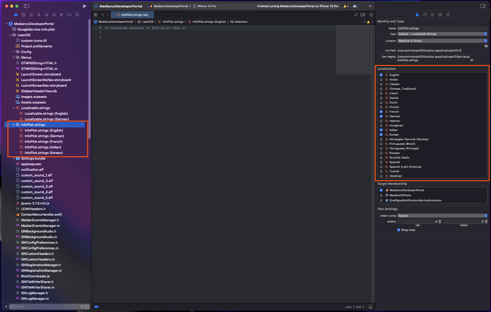
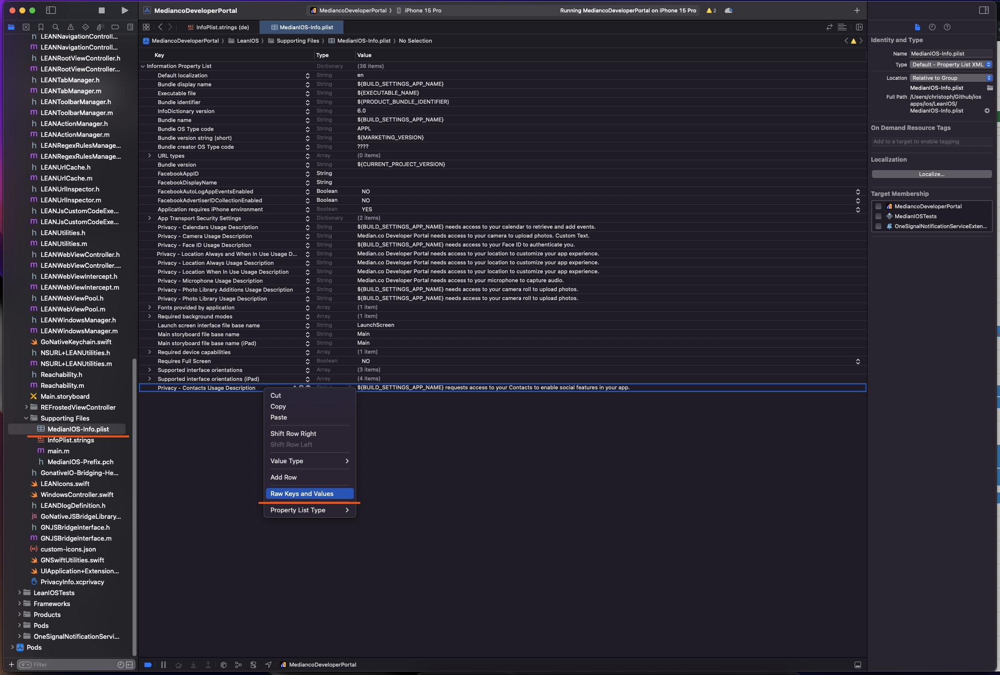
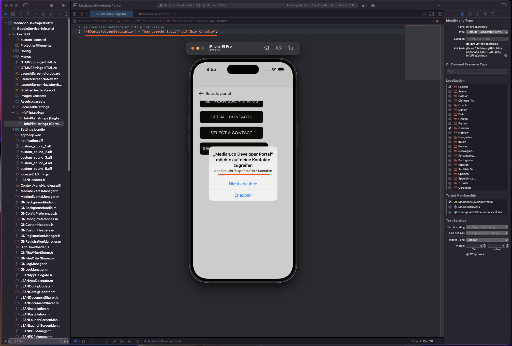

Median offers multilingual support for your web content. This section is specifically targeted to localize permission prompts which are native app components.

## Android

Permission prompts for Android are served by the system and as of writing, Android does not allow custom messages for their system permissions. The permission prompt will always be displayed in the locale of the user's device.

## iOS

Localization of permission prompts is not available in App Studio today, but the prompt to request permissions can be localized by adjusting the iOS source code and building the iOS app from the source.

Follow [Build iOS from source](/docs/build-ios-from-source) to obtain the source code of your app and open it in Xcode.

## InfoPlist.strings

Add your supported languages by selecting the checkboxes in the InfoPlist.strings file.

Once you select a supported language Xcode will create InfoPlist files for all languages selected.

<Frame caption="InfoPlist.strings">
  
</Frame>

### Locate the key you want to customize

Permission prompt texts are stored in the MedianIOS-Info.plist file. To customize the text you will need the raw key of the prompt to customize.

In the example below, you will find that the raw key for 'Privacy - Contacts Usage Description' is 'NSContactsUsageDescription'.

<Frame caption="MedianIOS-Info.plist">
  
</Frame>

### Customize the prompt

Using the raw key 'NSContactsUsageDescription' you can now set a custom permission description, which is shown for devices using the German language.

<Frame caption="German permission prompt">
  
</Frame>

## Frequently asked questions

<AccordionGroup>
<Accordion title="How can I test my translations on the iOS simulator?" id="how-can-i-test-my-translations-on-the-ios-simulator">

In order to test your localization you will need to set a language in the iOS simulator using Settings > General > Language. You may need to reset your simulator to revoke previously granted permissions for the app.

</Accordion>
</AccordionGroup>
