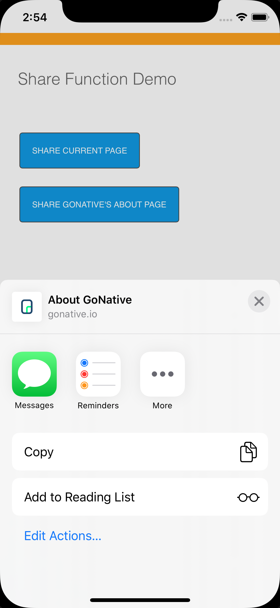
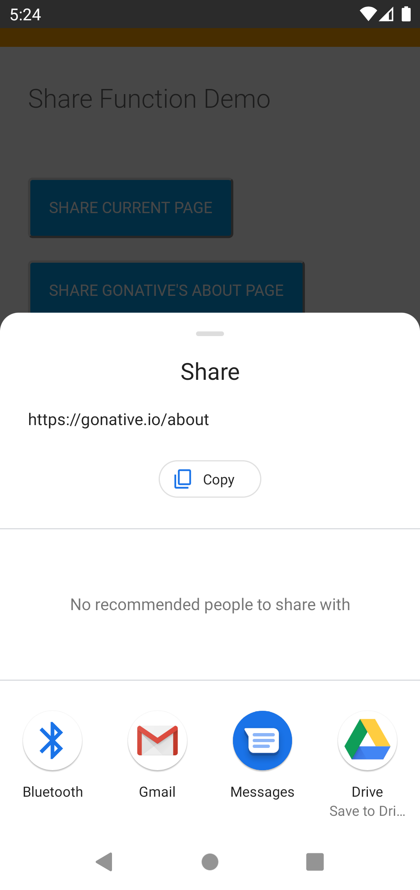

import { MedianLogo } from "/snippets/median-logo.jsx";
import { AppetizeEmbed } from "/snippets/appetize-embed.jsx";

Use the Median JavaScript Bridge to trigger the native share dialog on Android and iOS. This feature allows you to share a URL and optional message using your device's built-in sharing options.

You can call this method from your app's JavaScript context, including within native tab menus and sidebars.

<Check>
**Developer Demo**

Display our demo page in your app to test during development [https://median.dev/share-function](https://median.dev/share-function).

</Check>

## Implementation guide

The `median.share.sharePage()` is available with the following parameters.

To open the native share dialog, call:

<MedianLogo />
<CodeGroup>
```javascript JavaScript 
median.share.sharePage(); 
```
</CodeGroup>

You may also use the following to share a URL other than the current URL:

<MedianLogo />
<CodeGroup>
  ```javascript JavaScript
  median.share.sharePage({url: 'https://median.co/about'});
  ```
</CodeGroup>

You may also add some text which will be also shared along with the URL that you pass or the current URL:

<MedianLogo />
<CodeGroup>
  ```javascript JavaScript
  median.share.sharePage({url: 'https://median.co/about', text: 'Visit Median here'});
  ```
</CodeGroup>

## Native share dialog preview

The appearance of the share dialog and the available sharing options depend on the apps and services installed on the user's device. Simulators may show limited options due to system restrictions.

| iOS                                           | Android                                           |
| :-------------------------------------------: | :-----------------------------------------------: |
|  |  |
