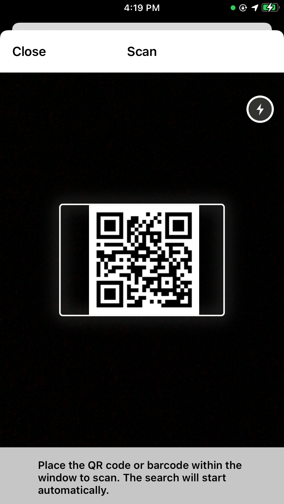
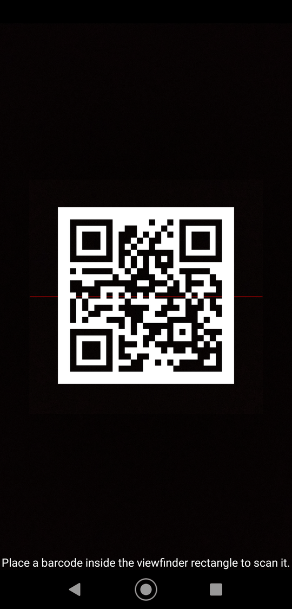
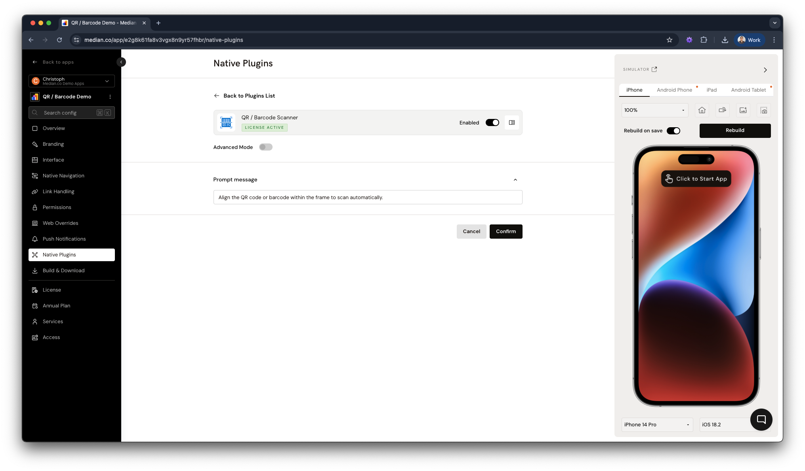

import { DeveloperDemo } from "/snippets/developer-demo.jsx";

import { MedianLogo } from "/snippets/median-logo.jsx";

Add QR code and barcode scanning to your mobile app using the device camera. Ideal for use cases such as:

- In-store retail shopping
- Warehouse and inventory management
- Data center asset tracking

The Median QR/Barcode Scanner plugin is built on top of customized, open-source libraries and offers full functionality without licensing fees or usage limits.

<DeveloperDemo path="qr-barcode" />

## Underlying open-source technologies

**Android**: [ZXing (Zebra Crossing) library](https://github.com/zxing/zxing)

**iOS**: [hyperoslo BarcodeScanner library](https://github.com/hyperoslo/BarcodeScanner)

## UI example

|                             iOS                              |                               Android                                |
| :----------------------------------------------------------: | :------------------------------------------------------------------: |
|  |  |

## Implementation guide

_Once the QR/Barcode Scanner plugin has been added to your app, you may use the following Median JavaScript Bridge commands to access its functionality._

### Start a QR/barcode scan

Use `median.barcode.scan()` to trigger the native scanner. By default, all supported formats trigger a scan. You can pass a `formats` array to restrict which code types can trigger a scan. If `formats` is omitted or empty, all supported types are scanned.\
The method supports both callback and Promise-based approaches:

<MedianLogo />
<CodeGroup>
  ```javascript JavaScript
  // Callback example
  median.barcode.scan({
    formats: ['QR_CODE', 'EAN_13'],
    callback: process_barcode
  });

function process_barcode(data) {
if (data.success) {
console.log('Got barcode: ' + data.code);
}
}

// Promise example
median.barcode.scan({ formats: ['QR_CODE'] }).then(function (data) {
if (data.success) {
console.log('Got barcode: ' + data.code);
}
});

// Scan all supported formats (default)
median.barcode.scan().then(function (data) {
if (data.success) {
console.log('Got barcode: ' + data.code);
}
});

````
</CodeGroup>

The native scanner UI will launch within your app. Upon scan completion, focus will return to the webview where an object in the format below will be returned.

<CodeGroup>
```json JSON
{
  success: true,      // boolean — true if a code was scanned
  type: "STRING",     // Symbology (e.g. 'qr', 'code128')
  code: "STRING",     // The actual scanned value
  error: "STRING"     // Error message if unsuccessful
}
````

</CodeGroup>

[Learn more about using promises and the Median JavaScript Bridge](/docs/javascript-bridge#promises).

**Supported formats**

- **QR Codes (2D):** QR_CODE, DATA_MATRIX, AZTEC, PDF_417
- **Barcodes (1D):** EAN_13, EAN_8, UPC_A, UPC_E, CODE_39, CODE_93, CODE_128, ITF, CODABAR

### Customizing the scanner prompt

You can customize the message shown to users during scanning by setting a prompt in the plugin settings. To do this, go to _Native Plugins > QR / Barcode Scanner_, as shown below.



### Set custom prompt message at runtime

You can also dynamically set the prompt message in-app using the `setPrompt()` method:

<MedianLogo />
<CodeGroup>
  ```javascript JavaScript median.barcode.setPrompt('Align the QR code or
  barcode within the frame to scan automatically'); ```
</CodeGroup>
