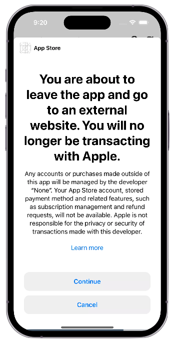

import { MedianLogo } from "/snippets/median-logo.jsx";

Apple allows apps offering digital content - such as magazines, newspapers, books, audio, music, and video - to link externally to their websites for account management and payments.

To able to offer this functionality within your app you require special permission from Apple to use the **External Link Account entitlement**. [Apple Documentation](https://developer.apple.com/support/reader-apps/).

<Check>
**Developer Demo**

Display our demo page in your app to test during development [https://median.dev/reader-modal/](https://median.dev/reader-modal/)

</Check>

## Implementation Guide

### Verify User's Ability to Make Payments

Before displaying and opening the external link to your website, confirm that the user is allowed to make purchases on their device. Use the following Median JavaScript Bridge method:

<MedianLogo />
<CodeGroup>
  ```JavaScript JavaScript 
  const {canMakePayments} = await median.readerModal.canMakePayments(); 
  ```
</CodeGroup>

### Display the Modal

Once you've verified that the user can make purchases, proceed to show the modal with the following method:

<MedianLogo />
<CodeGroup>
```JavaScript JavaScript 
median.readerModal.showModal(); 
```
</CodeGroup>

The modal will appear as shown below on devices running iOS 16+.

<Frame caption="In-App Modal Sheet">
  
</Frame>
