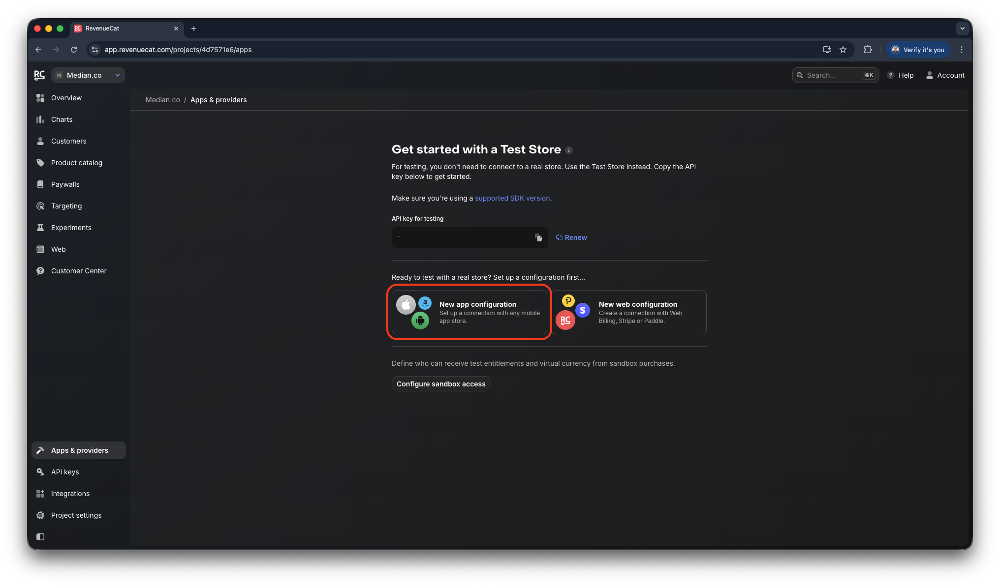
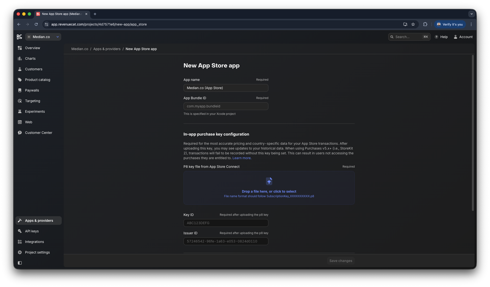
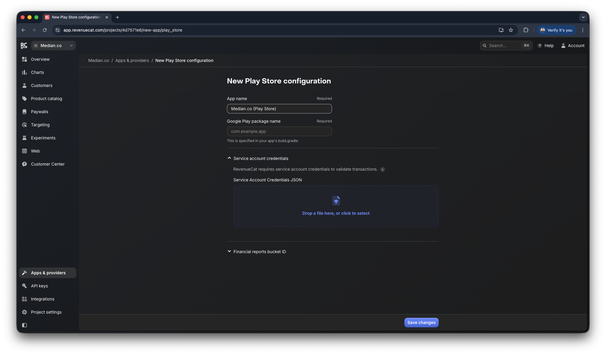
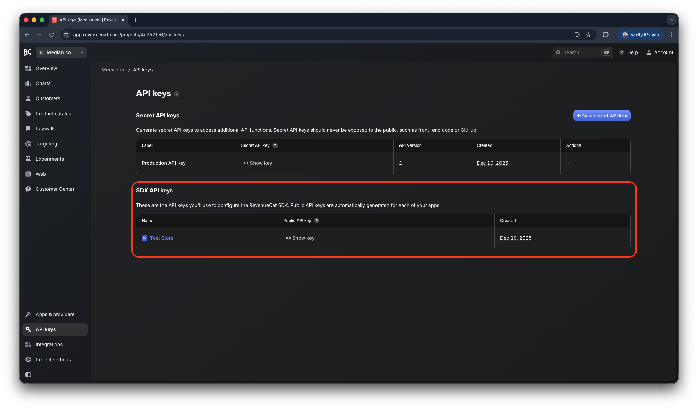
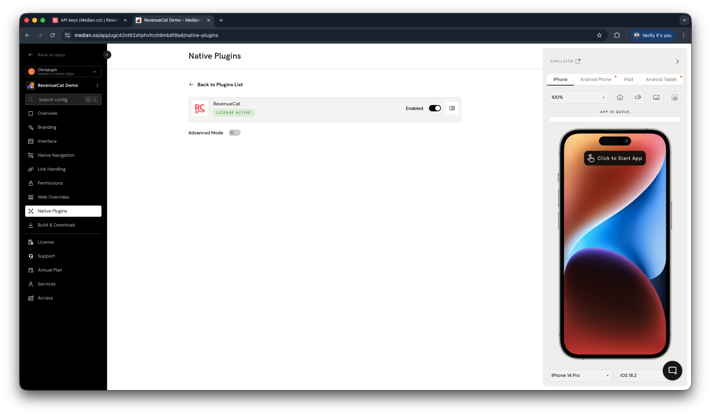

import { MedianLogo } from "/snippets/median-logo.jsx";

The RevenueCat plugin simplifies the integration of in-app purchases and subscriptions by leveraging RevenueCat’s backend and SDKs for iOS and Android.

This plugin provides a streamlined approach to fetching products, processing purchases, and restoring past transactions, reducing the complexity of implementing Apple’s StoreKit and Google Play Billing.

<Check>
**Developer Demo**

Display our demo page in your app to test during development [https://median.dev/revenue-cat](https://median.dev/revenue-cat)

</Check>

## Implementation guide

### RevenueCat setup

#### Step 1: Connect your mobile apps

Start by adding your iOS and Android apps in RevenueCat under Apps & Providers.

<Frame caption="RevenueCat: Apps & Providers">
  
</Frame>

##### Step 1.1: Create a new App Store app (iOS)

For your App Store App configuration you will need your App Bundle ID as well as your In-app purchase key configuration. You can find both pieces of information below:

- App Bundle ID: [iOS Bundle ID](/docs/app-identifiers#ios-bundle-id)
- In-app purchase key configuration: [Generate keys for In-App Purchases](https://developer.apple.com/help/app-store-connect/configure-in-app-purchase-settings/generate-keys-for-in-app-purchases/)

Business and Enterprise customers may request both values by creating a support ticket within App Studio, as our team will help with the setup and management of App Store Connect and the App Identifiers.

<Frame caption="RevenueCat: new App Store app">
  
</Frame>

##### Step 1.2: Create a new Play Store configuration (Android)

For your Play Store configuration you will need your Google Play package name as well as your Service account credentials. You can find both pieces of information below:

- Google Play package name: [Android Package Name](/docs/app-identifiers#android-package-name)
- Service Account Credentials: [Google Services](/docs/google-services)

Business and Enterprise customers may request both values by creating a support ticket within App Studio, as our team will help with the setup and management of Google Firebase and the App Identifiers.

<Frame caption="RevenueCat: new Play Store configuration">
  
</Frame>

#### Step 2: Retrieve your RevenueCat API key

You must initialize the SDK using your public API key. RevenueCat provides a test API key by default so you can validate purchases before going live.

<Frame caption="RevenueCat: SDK API keys">
  
</Frame>

#### Step 3: Set up your products

Follow the steps in the official [RevenueCat product configuration guide](https://www.revenuecat.com/docs/offerings/products-overview) to review your Test Store products, or set up or import real store products.

### App configuration

Enable the RevenueCat plugin in the **Native Plugins** tab as shown below. The plugin does not require configuration fields because initialization happens at runtime using the JavaScript Bridge API.

<Frame caption="RevenueCat plugin enablement">
  
</Frame>

### JavaScript Bridge functions

#### SDK initialization

To use the RevenueCat plugin, initialize it with your public `apiKey` and `appUserID`. References to both can be found in the [RevenueCat documentation](https://www.revenuecat.com/docs/projects/authentication). The `appUserID` will allow you to reference users in the RevenueCat dashboard, via the API, as well as in the webhooks and other integrations.

Provide a callback function or return a promise.

<MedianLogo />
<CodeGroup>
  ```javascript JavaScript
  median.revenueCat.configure({
    'apiKey': '<my_api_key>',
    'appUserID': '<my_app_user_id>'
  })
  // Return value:
  {
    "success": true | false
  }
  ```
</CodeGroup>

#### Verify SDK initialization

Verify the SDK is initialized before calling any other methods. Provide a callback function or return a promise.

<MedianLogo />
<CodeGroup>
  ```javascript JavaScript
  median.revenueCat.isInitialized({'callback': function});
  // Return value:
  {
    'initialized': true | false,
    'apiKey': STRING // available only if initialized is true
  }
  ```
</CodeGroup>

#### Retrieve offerings

Fetch available in-app products, subscriptions, and offerings from RevenueCat.

Provide a callback function or return a promise.

<MedianLogo />
<CodeGroup>
  ```javascript JavaScript
  median.revenueCat.getOfferings()
  // Return value:
  {
    "identifiers": ["$subscription_monthly","$subscription_annual","$subscription_lifetime"]
  }
  ```
</CodeGroup>

#### Make a purchase

Trigger an in-app purchase using a product identifier.

Provide a callback function or return a promise.

<MedianLogo />
<CodeGroup>
  ```javascript JavaScript
  median.revenueCat.purchase({'identifier':STRING})
  // Return value:
  {
    "success": true | false
  }
  ```
</CodeGroup>

#### Restore purchases

Restore a user's previously purchased products and subscriptions.

Provide a callback function or return a promise.

<MedianLogo />
<CodeGroup>
  ```javascript JavaScript
  median.revenueCat.restorePurchases()
  // Return value:
  {
    "success": true | false
  }
  ```
</CodeGroup>

#### Present a paywall

Present a paywall that has been configured through the RevenueCat platform. Please follow the [RevenueCat: Creating paywalls](https://www.revenuecat.com/docs/tools/paywalls/creating-paywalls) guide for style and configuration references.

<MedianLogo />
<CodeGroup>
```javascript JavaScript 
median.revenueCat.presentPaywall(); 
```
</CodeGroup>

This function provides a callback and will return an error if the user cancels the paywall.

## Troubleshooting

### Can Median manage my RevenueCat configuration?

Median maintains its own RevenueCat account for development and QA purposes only. However, Median does not manage your RevenueCat configuration, product setup, or App Store or Google Play metadata.

If you run into issues, consult RevenueCat’s official troubleshooting documentation:

[RevenueCat: Troubleshooting the SDKs](https://www.revenuecat.com/docs/test-and-launch/debugging/troubleshooting-the-sdks)

### What are the App Review implications when using paywalls?

Paywalls are often one of the most closely reviewed parts of an app during App Store and Google Play review. Both platforms require apps to clearly communicate what users receive before they are asked to pay, ensuring expectations are transparent and not misleading.

When configuring your payment options and paywalls, carefully follow RevenueCat’s guidance to improve your chances of approval:

[RevenueCat: Getting your paywall approved through app review](https://www.revenuecat.com/docs/tools/paywalls/creating-paywalls/app-review)
