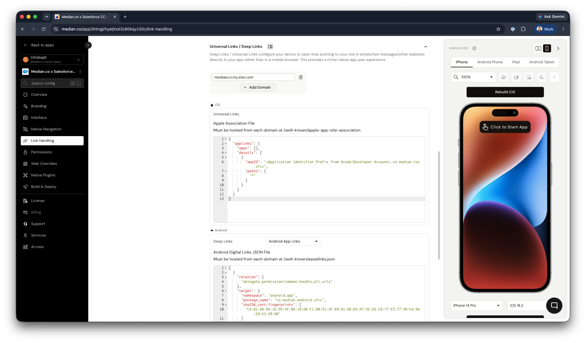

Deep linking allows URLs to your Experience Cloud site to open the native Median app rather than the mobile browser. This guide covers the Salesforce-specific challenge of hosting the required domain verification files on a managed platform, and provides working Apex and Visualforce code for both iOS and Android.

This is part three of a four-part series:

1. [Getting Started with Salesforce Experience Cloud](/docs/getting-started-with-salesforce-experience-cloud)
2. [Lightning Web Components and the JavaScript Bridge](/docs/salesforce-lwc-median)
3. **Deep Linking** (this page)
4. [Salesforce LWC Component Deployment and Reference](/docs/salesforce-lwc-components)

## How deep linking works

Apple (iOS) and Google (Android) each require you to prove ownership of your domain before they allow URLs to that domain to open a native app. Proof of ownership is established by hosting a JSON file at a specific well-known path on your domain:

| Platform | Required path                             |
| -------- | ----------------------------------------- |
| iOS      | `/.well-known/apple-app-site-association` |
| Android  | `/.well-known/assetlinks.json`            |

The challenge with Salesforce Experience Cloud is that it is a managed platform. You cannot place arbitrary files in the web root of your domain the way you would with a traditional web server. Both files must instead be served through the Salesforce platform itself.

**Before starting:** For production apps, configure your custom domain in Salesforce Setup before setting up deep linking. Deep linking must be configured against the domain end users will see. The Salesforce-generated `.my.site.com` domain may not work correctly with App Store or Play Store universal link verification.

## Step 7a: Apple app site association (AASA) for iOS

### Create the Apex controller for iOS

Create a public Apex class that returns the AASA JSON payload. Replace `TEAMID` with your Apple Developer Team ID and update the bundle identifier to match your app:

<CodeGroup>
  ```apex apex
  public class AASAController {
      public String getJson() {
          return '{"applinks":{"apps":[],"details":[{"appID":"TEAMID.com.yourorg.appname","paths":["*"]}]}}';
      }
  }
  ```
</CodeGroup>

Your Apple Developer Team ID is available in the [Apple Developer portal](https://developer.apple.com/account) under Membership Details.

### Create the Visualforce page for iOS

Create a Visualforce page that serves the JSON with the correct content type. The page must be publicly accessible without authentication:

<CodeGroup>
  ```apex apex
  <apex:page
      controller="AASAController"
      contentType="application/json"
      showHeader="false"
      sidebar="false"
      standardStylesheets="false"
  >{!json}</apex:page>
  ```
</CodeGroup>

In Salesforce Setup, navigate to **Sites** and confirm the Visualforce page is listed under the public pages for your site.

### Configure the URL rewrite for iOS

Map the well-known path to the Visualforce page using one of two approaches:

**Option A: Custom URL Redirects (simpler)**

In Salesforce Setup, navigate to **Sites > \[Your Site] > Custom URLs** and create a redirect from `/.well-known/apple-app-site-association` to the Visualforce page URL.

**Option B: Site URL Rewriter Class (more control)**

Implement the `Site.UrlRewriter` interface in an Apex class and register it under **Sites > \[Your Site] > Site URL Rewriter**. This approach gives you programmatic control over the mapping and is preferred for orgs that already use a URL rewriter for other purposes.

### Verify the AASA file

Before submitting your app to the App Store, verify that the file is reachable and valid:

1. Visit `https://yourdomain.com/.well-known/apple-app-site-association` in a browser and confirm it returns JSON without requiring a login.
2. Use the [Median.co Deep Linking Validator](https://median.co/deep-linking-validator/) to check the payload format.
3. Confirm the `appID` value matches your app's bundle identifier and Team ID exactly. A mismatch here is the most common cause of deep linking failures.

## Step 7b: Asset links for Android

### Create the Apex controller for Android

Create a separate Apex class for the Android Asset Links payload. Replace the package name and certificate SHA-256 fingerprint with the values from your app:

<CodeGroup>
  ```apex apex
  public class AssetLinksController {
      public String getJson() {
          return '[{"relation":["delegate_permission/common.handle_all_urls"],"target":{"namespace":"android_app","package_name":"com.yourorg.appname","sha256_cert_fingerprints":["YOUR_CERT_SHA256_FINGERPRINT"]}}]';
      }
  }
  ```
</CodeGroup>

Your SHA-256 certificate fingerprint is available in the App Studio (**Link Handling > Universal Links / Deep Links**), in the Google Play Console under **Setup > App Integrity**, or from your keystore using `keytool -list -v -keystore your.keystore`.

### Create the Visualforce page for Android

<CodeGroup>
  ```apex apex
  <apex:page
      controller="AssetLinksController"
      contentType="application/json"
      showHeader="false"
      sidebar="false"
      standardStylesheets="false"
  >{!json}</apex:page>
  ```
</CodeGroup>

### Configure the URL rewrite for Android

Map `/.well-known/assetlinks.json` to the Visualforce page using the same approach as for the AASA file above.

### Verify the asset links file

1. Visit `https://yourdomain.com/.well-known/assetlinks.json` in a browser and confirm it returns JSON without requiring a login.
2. Use the [Median.co Deep Linking Validator](https://median.co/deep-linking-validator/) to validate the payload.

## Step 7c: Configure deep linking in Median App Studio

Once both verification files are in place:

1. In Median App Studio, navigate to **Link Handling > Universal Links / Deep Links.**
2. Add your custom domain.

<Frame caption="App Studio - Deep Link Configuration">
  
</Frame>

## Troubleshooting: Deep links open the browser instead of the app

If tapping a link opens the mobile browser rather than the app, work through the following checks in order:

1. **File accessibility.** Visit both well-known URLs in a browser while logged out of Salesforce. If you are redirected to a login page, the Visualforce page is not marked as publicly accessible. Check the Guest User profile permissions for the page under **Sites > \[Your Site] > Public Access Settings**.
2. **JSON validity.** A single character error in the JSON payload causes silent verification failure. Use the validators linked above to confirm both files parse correctly.
3. **Domain mismatch.** Confirm the domain in your Median deep linking configuration matches the domain where the verification files are hosted. Deep linking is domain-specific; a redirect from `.my.site.com` to a custom domain will not carry the verification through.
4. **App Store / Play Store propagation.** Apple and Google cache AASA and Asset Links verification at app install time. If you updated the files after the app was installed on a test device, uninstall and reinstall the app to force a fresh verification check.

[Lightning Web Components and the Median JavaScript Bridge](/docs/salesforce-lwc-median)

[Salesforce LWC Component Deployment and Reference](/docs/salesforce-lwc-components)
