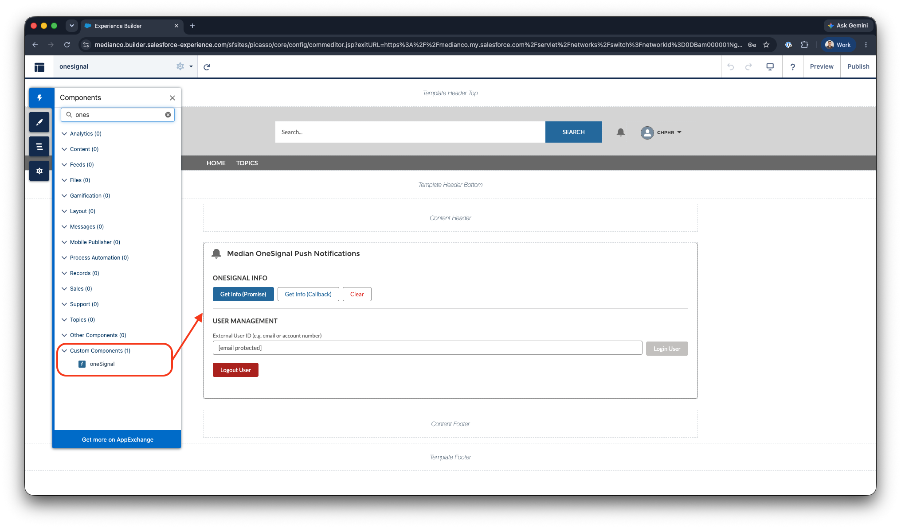

import MedianLogo from '/snippets/median-logo.jsx';

This guide covers deploying the open-source `median-salesforce-components` library into your Salesforce org and provides a full API reference for each component. It also includes the recommended patterns for building your own custom components that call the Median JavaScript bridge.

This is part four of a four-part series:

1. [Getting Started with Salesforce Experience Cloud](https://docs.median.co/docs/getting-started-with-salesforce-experience-cloud)
2. [Lightning Web Components and the Median JavaScript Bridge](https://docs.median.co/docs/salesforce-lwc-median)
3. [Deep Linking for Salesforce Experience Cloud](https://docs.median.co/docs/salesforce-deep-linking)
4. **Component Deployment and Reference** (this page)

## Step 8: Deploy the Open-Source Component Library

The [median-salesforce-components <Icon icon="arrow-up-right-from-square" size={12} />](https://github.com/gonativeio/median-salesforce-components) repository provides ready-to-deploy reference LWC components covering common Median integration patterns for Salesforce. All components have been tested on physical iOS and Android devices inside a Median-wrapped Experience Cloud app.

### Deploy All Components

<CodeGroup>
  ```bash Bash
  git clone https://github.com/gonativeio/median-salesforce-components.git
  cd median-salesforce-components
  sf org login web --alias my-org
  sf project deploy start --source-dir force-app --target-org my-org
  ```
</CodeGroup>

### Deploy a Single Component

<CodeGroup>
  ```bash bash
  sf project deploy start --source-dir force-app/main/default/lwc/oneSignal --target-org my-org
  ```
</CodeGroup>

### Add Components to an Experience Builder Page

After deployment, open Experience Builder and drag the component from the component panel onto your page. All four components support the following targets:

* `lightningCommunity__Page`
* `lightningCommunity__Default`
* `lightning__AppPage`
* `lightning__RecordPage`

<Frame caption="Experience Builder - Custom Components">
  
</Frame>

## Building a Custom Component

If you are building your own LWC that calls the Median bridge, follow these conventions for production-ready code. The patterns below are consistent with the open-source library and ensure correct behaviour across Lightning Web Security, multiple Median SDK versions, and both in-app and out-of-app contexts.

<CodeGroup>
  ```javascript JavaScript
  import { LightningElement } from 'lwc';
  
  export default class MyMedianComponent extends LightningElement {
  
      // Normalise both casing conventions across Median SDK injection methods (NPM or app-injected)
      get _median() {
          return window.median || window.Median || null;
      }
  
      // Always guard before calling the bridge
      get isInMedianApp() {
          return !!this._median;
      }
  
      // Example: call an async bridge method with error handling
      async exampleBridgeCall() {
          if (!this._median) {
              // Component is running outside the Median app - degrade gracefully
              return;
          }
          try {
              const result = await this._median.someFeature.someMethod();
              // Handle result
          } catch (e) {
              console.error('[MyMedianComponent] exampleBridgeCall error:', e);
          }
      }
  }
  ```
</CodeGroup>

## Component Reference

### oneSignal: Push Notifications

| **Source** | `force-app/main/default/lwc/oneSignal` |
| --- | --- |
| **Median plugin required** | OneSignal (enabled in Median App Studio under Plugins) |
| **Apex required**          | No                                                     |

Integrates the Median OneSignal plugin to manage push notification subscriptions. Provides the ability to retrieve device subscription info, associate a device with a Salesforce user via an external ID, and remove that association on logout.

**Relevant for:** customer communities where personalised push notifications are sent based on CRM data, such as case status updates, appointment reminders, or order confirmations.

**Features:**

* Get OneSignal device info via Promise or global callback
* Login a user by external ID (e.g. Salesforce Contact email or Account ID)
* Logout the current user and remove the external ID association
* Graceful degradation with warning banner outside the Median app

**Median JavaScript Bridge methods used:**

<MedianLogo />

<CodeGroup>
  ```javascript JavaScript
  median.onesignal.info()                          // Promise
  median.onesignal.info({ callback: 'fnName' })    // Callback
  median.onesignal.login(externalUserId)           // Promise
  median.onesignal.logout()                        // Promise
  ```
</CodeGroup>

**Usage note:** The external user ID is typically a Salesforce Contact ID, email address, or another identifier that your push notification service can use to target a specific user. Logout removes the external ID association but does not unsubscribe the device from push notifications entirely.

<Info>
  This component only implements a subset of all JavaScript Bridge methods available. Please review our [OneSignal documentation](https://docs.median.co/docs/onesignal) for a full JavaScript Bridge Reference.
</Info>

### biometricAuth: Biometric Authentication

| **Source** | `force-app/main/default/lwc/biometricAuth` |
| --- | --- |
| **Median plugin required** | Face ID and Touch ID / Android Biometric, enabled in Median App Studio under Plugins |
| **Apex required**          | No                                                                                   |

Saves and retrieves credentials using the device's native biometric hardware (Face ID on iOS, Fingerprint or Face Unlock on Android). Secrets are stored in the iOS Keychain or Android Keystore and are never written to Salesforce fields or browser storage.

**Relevant for:** field service, healthcare, and financial services applications where users authenticate repeatedly throughout the day and friction at login measurably reduces adoption.

**Features:**

* Check whether the device supports biometrics and whether a secret is already stored
* Save a username and password as a JSON-encoded secret (no biometric prompt required to save)
* Retrieve a stored secret via a native biometric prompt, rendered in a read-only output field without navigating away from the page
* Delete the stored secret from the device keychain or keystore

**Median JavaScript Bridge methods used:**

<MedianLogo />

<CodeGroup>
  ```javascript JavaScript
  median.auth.status()                                    // Promise → { hasTouchId, hasSecret }
  median.auth.save({ secret, minimumAndroidBiometric })   // Promise
  median.auth.get({ callbackFunction: 'fnName' })         // Callback → { success, secret, error }
  median.auth.delete()                                    // Promise
  ```
</CodeGroup>

**Usage note:** `minimumAndroidBiometric` is set to `'strong'` by default, which requires Class 3 (hardware-backed) biometrics on Android. Change this value in `medianAuth.js` if your target device fleet uses Class 2 biometrics. Secrets are encoded as a JSON string in the format `{ "username": "...", "password": "..." }`. Modify the `saveSecret()` method if you need to store a different data shape.

***

### qrScannerNative: QR Code and Barcode Scanning

| **Source** | `force-app/main/default/lwc/qrScannerNative` |
| --- | --- |
| **Median plugin required** | QR / Barcode Scanner (enabled in Median App Studio under Plugins) |
| **Apex required**          | No                                                                |

Launches the device camera for QR code and barcode scanning. Returns the scanned value directly into the LWC component's reactive state without navigating away from the page. Supports both Promise and global callback invocation patterns.

**Relevant for:** inventory management, asset tracking, event check-in, and field inspection workflows where users need to scan physical identifiers and match them to Salesforce records.

**Features:**

* Set a custom prompt message displayed inside the native scanner UI
* Scan via Promise (simpler code, recommended for most use cases)
* Scan via global callback (required for some Median SDK versions or where Promise is not available)
* Full raw JSON output in a resizable read-only textarea
* Structured result card showing scanned code and barcode type
* Loading spinner shown while the native scanner UI is open
* Graceful handling of user cancellation

**Median JavaScript Bridge methods used:**

<MedianLogo />

<CodeGroup>
  ```javascript JavaScript
  median.barcode.setPrompt(promptText)             // Synchronous
  median.barcode.scan()                            // Promise
  median.barcode.scan({ callback: 'fnName' })      // Callback
  ```
</CodeGroup>

**Scan result shape:**

<CodeGroup>
  ```javascript JavaScript
  {
    "success": true,
    "code": "https://example.com/asset/12345",
    "type": "QR_CODE"
  }
  ```
</CodeGroup>

On cancellation, the scanner returns `{ "success": false, "error": "cancelled" }`. This is handled gracefully with a status badge rather than an error state.

### pdfViewer: Native PDF Handling

| **Source** | `force-app/main/default/lwc/pdfViewer` |
| --- | --- |
| **Median plugin required** | No                                     |
| **Apex required**          | No                                     |

Opens and downloads PDF files using the device's native PDF viewer. Configure a default PDF URL via a constant at the top of `pdfViewer.js`, and optionally override it at runtime via the URL input field.

**Relevant for:** portals that serve policy documents, contracts, inspection reports, field manuals, or any other PDF that users need to view, annotate, or share from their device.

**Features:**

* Hardcoded default PDF URL (set `DEFAULT_PDF_URL` in `pdfViewer.js`)
* Editable URL input field for runtime testing without redeployment
* Read-only URL display textbox showing the active URL before triggering an action
* Open PDF using `window.location.href`, which the Median native layer intercepts and renders in PDFKit (iOS) or PDFViewer (Android) without leaving the page
* Download PDF to the device via `median.share.downloadFile()` (Android: Downloads folder; iOS: native Share / Save to Files sheet)

**Configuration:**

Open `pdfViewer.js` and update the constant at the top of the file:

<CodeGroup>
  ```javascript JavaScript
  // Line 4 of medianPdfViewer.js
  const DEFAULT_PDF_URL = 'https://your-domain.com/your-document.pdf';
  ```
</CodeGroup>

The URL must be publicly accessible, or must be a URL that the Median webview session can reach using the existing Salesforce authentication cookie.

**Median JavaScript Bridge methods used:**

<MedianLogo />

<CodeGroup>
  ```javascript JavaScript
  window.location.href = url;                        // Open — no bridge call required
  median.share.downloadFile({ url, open: false })    // Download
  ```
</CodeGroup>

**Button behaviour by context:**

| Button          | Inside Median app       | Desktop browser                  |
| --------------- | ----------------------- | -------------------------------- |
| Open PDF in App | Opens native PDF viewer | Navigates browser to the PDF URL |
| Download PDF    | Downloads to device     | Disabled (bridge not present)    |
