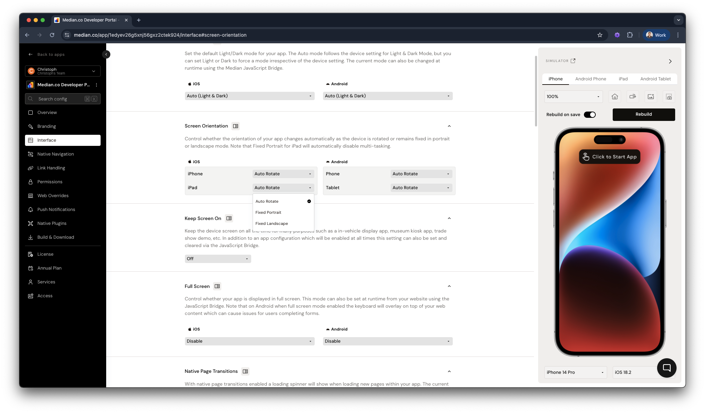

Easily manage how your app responds to device rotation by configuring screen orientation settings. Choose whether your app automatically rotates based on device movement or remains fixed in either portrait or landscape mode.

<Warning>
  **iOS Tablets**

  Enabling Fixed Portrait mode on iPads will automatically disable multi-tasking capabilities.
</Warning>

<Frame caption="Screen Orientation Configuration">
  
</Frame>

## Frequently asked questions

<AccordionGroup>
<Accordion title="Can I lock my app’s orientation to Portrait or Landscape?" id="can-i-lock-my-apps-orientation-to-portrait-or-landscape">

Yes, you can configure your app to use one of the following screen orientation modes:

* **Auto-Rotation**: Allows the app to rotate automatically based on device orientation.
* **Fixed Portrait**: Locks the app to portrait mode only.
* **Fixed Landscape**: Locks the app to landscape mode only.

These settings can be customized based on:

* **Operating System**: iOS or Android
* **Device Type**: Phone or Tablet

</Accordion>
</AccordionGroup>
