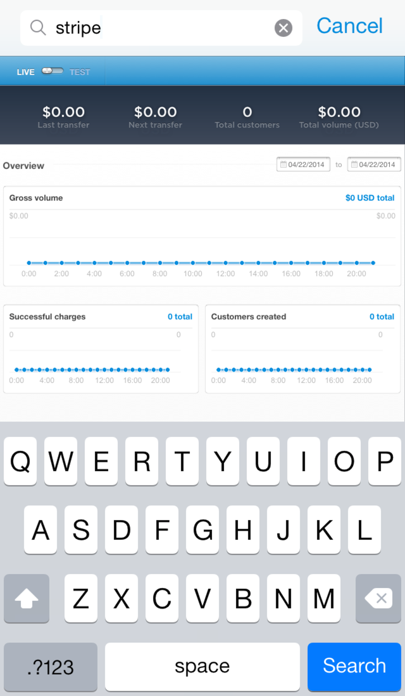
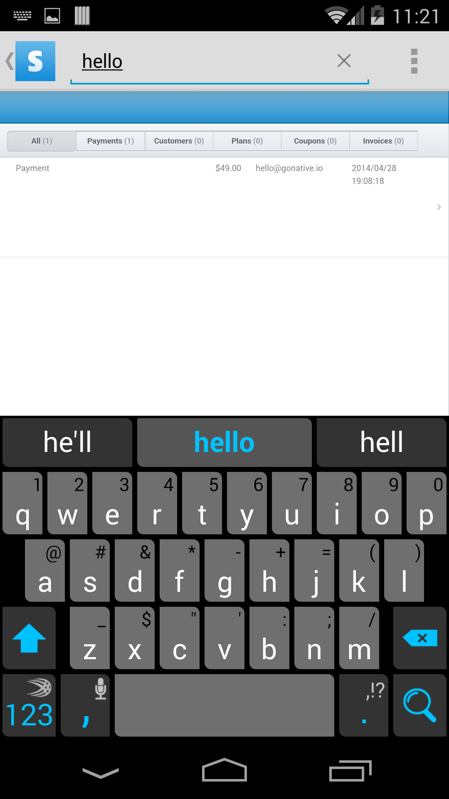

Configure a native search button with embedded search form in the top native toolbar to add native capabilities to your existing web-based search.

<Info>
  Search terms will be appended to the URL entered, e.g. Google would be entered as `https://www.google.com/?q=`
</Info>

<Columns cols={2}>
  <Frame caption="iOS – Native Search Form">
    
  </Frame>
  <Frame caption="Android – Native Search Form">
    
  </Frame>
</Columns>

Supporting native search will add a magnifying glass button in the [Top Navigation Bar](/docs/top-navigation-bar) (Android ActionBar and iOS NavigationBar). Upon clicking the search icon, users will be able to enter `[search terms]`. These `[search terms]` will simply be appended to the Template Search URL specified.

For example, all Google.com searches can be represented using the URL syntax `https://www.google.com/#q=[search terms]`.
