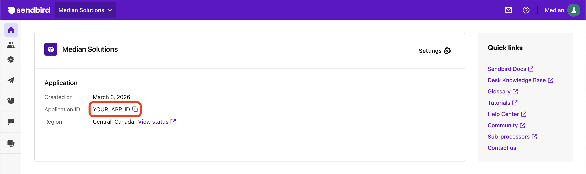
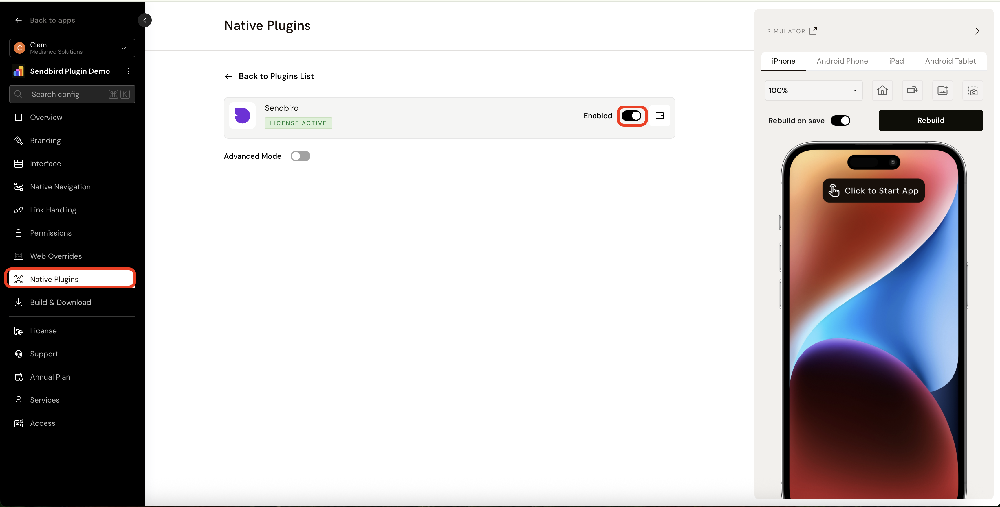
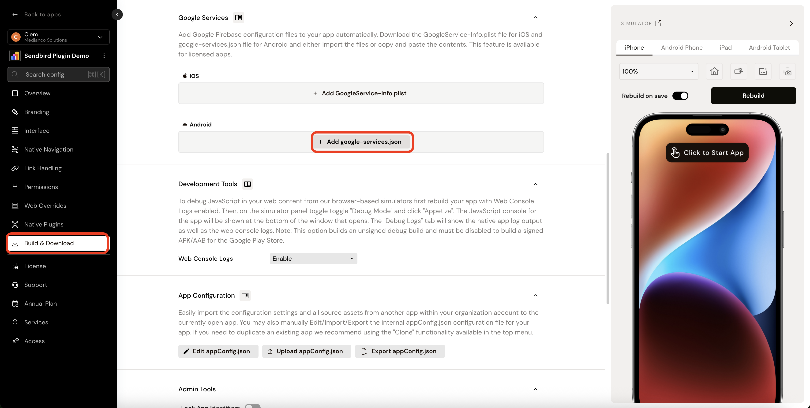

import { MedianLogo } from "/snippets/median-logo.jsx";

The Sendbird plugin simplifies integrating in-app messaging and push notifications by leveraging Sendbird’s UI kit and SDKs for iOS and Android. It provides a straightforward way to build modern messenger experiences and send real-time push notifications.

## Why use Sendbird?

- **Messaging interface and system**: Use Sendbird’s chat interface and features instead of building yours from scratch.
- **Real-time push**: Deliver push notifications to Android and iOS devices using Sendbird.
- **JavaScript Bridge API**: Initialize the SDK, manage users, channels, permissions, and UI from your web layer.

## When to use this plugin

| Use Case | Example |
| --- | --- |
| **In-app messaging** | Let users chat in group channels using Sendbird’s native messaging UI. |
| **Push notifications** | Deliver Sendbird push notifications via APNs (iOS) and FCM (Android). |
| **User sessions** | Log users in with `userId`, update profile info, disconnect or log out as needed. |
| **Channel creation** | Create group channels programmatically and open them in the Sendbird UI. |
| **Demo-driven development** | Load the developer demo in your app to test integration during development |

## What you'll do

Use this section as a fast navigation map into the full setup and implementation details:

1. **Configure Sendbird and push**: Complete [Plugin Platform Setup](#plugin-platform-setup)—retrieve your Application ID, gather APNs (iOS) and FCM (Android) credentials, and enable push with those credentials in the Sendbird dashboard.
2. **Enable and configure in Median**: In [Median App Studio Configuration](#median-app-studio-configuration), complete [Enable the Plugin](#enable-the-plugin), review [Configuration Options](#configuration-options) (including optional Advanced Configuration), and for Android upload `google-services.json` as described under **Android — `google-services.json`** in that section.
3. **Implement the bridge**: Use [Website Configuration (JavaScript Bridge)](#website-configuration-javascript-bridge) for SDK initialization, push permission, users, channels, and Sendbird UI (`showUI` / `showChannelUI` / close callback).
4. **Validate your flow**: Use [Create Group Channel](#create-group-channel) and [Show Channels UI and Enter Channel](#show-channels-ui-and-enter-channel) to confirm end-to-end behavior.
5. **Test and resolve issues**: Work through [Testing](#testing) and [Troubleshooting](#troubleshooting).

<Check>
  **Developer Demo**

  Display our demo page in your app to test during development [https://median.dev/sendbird/ <Icon icon="arrow-up-right-from-square" size={12} />](https://median.dev/sendbird)
</Check>

## Prerequisites

- A Median.co app with the JavaScript Bridge enabled
- A Sendbird application and its **Application ID** (from the Sendbird dashboard)
- For **Apple Push Notification service (iOS)**: App Bundle ID (see Median [iOS Bundle ID](/docs/app-identifiers#ios-bundle-id)), `.p8` or `.p12` authentication token ([Register iOS app with APNs <Icon icon="arrow-up-right-from-square" size={12} />](https://developer.apple.com/documentation/usernotifications/registering-your-app-with-apns)), Key ID, Team ID, and SSL certificate type
- For **Firebase Cloud Messaging (Android)**: FCM **service account key (HTTP v1)** (generate a new private key under **Project settings → Service accounts** in the Firebase console)
- For Android push: `google-services.json` uploaded in Median App Studio (**Build & Deploy**), and the FCM service account key (HTTP v1) configured in the Sendbird dashboard (see setup steps below)

### Key concepts

The following terms will help you implement Sendbird effectively:

**Sendbird Application ID (`appId`)**: Identifies your Sendbird application. The SDK needs it to initialize; it is shown in your Sendbird dashboard (see Sendbird setup).

**Push credentials (APNs / FCM)**: Values you add in the Sendbird dashboard under **Settings → Push Notifications** so Sendbird can send pushes to your iOS and Android apps.

**Group channel**: A channel where multiple users chat. Creating one returns a `channelUrl` you can use to open the channel in the UI.

**Distinct channel (`isDistinct`)**: When `true`, if a matching channel already exists, that channel is reused instead of creating a duplicate.

<Info>
  **Important considerations**

  - If you need help locating push or Firebase values, contact Median support.
  - Android FCM requires `google-services.json` in the app **and** FCM configuration in the Sendbird dashboard (including the FCM service account key (HTTP v1)).
</Info>

## Integration guide

### Plugin platform setup

Configure Sendbird and push outside Median.co before or in parallel with the App Studio settings.

#### Retrieve your Sendbird application ID

Sendbird’s SDK requires the **Application ID** of your Sendbird application to initialize. You can find it in the dashboard of your Sendbird application.

<Frame caption="Sendbird – Find Application ID">
  
</Frame>

#### Setup Sendbird push notifications (APNs and FCM)

To deliver Sendbird push notifications to an app, you need the following credentials.

**For Apple Push Notification service (iOS):**

- App Bundle ID: Median [iOS Bundle ID](/docs/app-identifiers#ios-bundle-id)
- `.p8` or `.p12` authentication token — [Register iOS app with APNs <Icon icon="arrow-up-right-from-square" size={12} />](https://developer.apple.com/documentation/usernotifications/registering-your-app-with-apns)
- Key ID
- Team ID
- SSL certificate type

**For Firebase Cloud Messaging (Android):**

- Service account key (HTTP v1) — you can generate a new private key under **Project settings → Service accounts** on your Firebase console

Please reach out to Median support for help with finding these values.

#### Sendbird dashboard: Enable push and add credentials

In the dashboard of your Sendbird app:

1. Navigate to **Settings → Push Notifications**.
2. Enable push notifications.
3. Add your push notification credentials.

<Frame caption="Sendbird – Push Notification Settings">
  
</Frame>

### Median App Studio configuration

#### Enable the plugin

1. In **App Studio**, open the **Native Plugins** tab and enable the **Sendbird** plugin.

<Frame caption="App Studio – Enable Sendbird plugin">
  
</Frame>

#### Configuration options

For advanced configuration, add the parameters below to the **Advanced Configuration** field (optional):

<CodeGroup>

```javascript JavaScript
{
"active": true | false,
"autoRegister": true | false,
// if true push permission will be requested automatically
"appId": STRING  // optional - if defined the Sendbird SDK will be initialized automatically
}
```

</CodeGroup>

| Setting | Description |
| --- | --- |
| **`active`** | `true` or `false`. |
| **`autoRegister`** | `true` or `false` — if `true`, push permission is requested automatically. |
| **`appId`** | Optional string — if defined, the Sendbird SDK is initialized automatically. |

#### Android: `google-services.json`

Firebase Cloud Messaging (FCM) requires embedding a `google-services.json` file in the app to send Android push notifications. Upload this file in the **Build & Deploy** tab of App Studio.

<Frame caption="App Studio – Add google-services.json">
  
</Frame>

Push notifications must also be configured in your **Sendbird** dashboard by adding the FCM service account key (HTTP v1). Refer to the Sendbird push setup steps above.

### Website configuration (JavaScript Bridge)

Unless noted, you may provide a **callback** or use the **promise** returned by the call.

#### Initialize the SDK

Initialize the Sendbird SDK using the `appId` of your Sendbird application. Once initialized, the `appId` is saved and the SDK initializes automatically on the next app start. The `appId` lets you reference users and channels for that Sendbird application. See the Sendbird dashboard screenshot in setup for locating `appId`.

<MedianLogo />

<CodeGroup>

```javascript JavaScript
median.sendbird.initialize(STRING);
```

</CodeGroup>

**Parameters:** `appId` (string) — Sendbird Application ID.

#### Verify SDK initialization

<MedianLogo />

<CodeGroup>

```javascript JavaScript
median.sendbird.isInitialized({callback: function})
// Return value if initialized:
{
  "initialized": true,
  "appId": STRING
}
// Return value if not initialized (appId not provided or is invalid):
{
  "initialized": false
}
```

</CodeGroup>

#### Request push notification permission
Request push notification permission. On iOS and Android 13+, a system dialog is shown. On Android 12 and below, permission is granted without user input.

<MedianLogo />

<CodeGroup>

```javascript JavaScript
median.sendbird.promptNotification({'callback': function})

// Return value:
{
"granted": true | false
}
```

</CodeGroup>

#### Check push notification permission status
Check whether push notification permission has been granted or denied.

<MedianLogo />

<CodeGroup>

```javascript JavaScript
median.sendbird.notificationEnabled({'callback':  function})

// Return value:
{
  "granted": true | false
}
```

</CodeGroup>

#### Sign in or register users
Log in a user on the Sendbird application using `userId`. If the user is not logged out, they stay logged in on future app starts. If `userId` does not exist, a new user is registered.

<MedianLogo />

<CodeGroup>

```javascript JavaScript
median.sendbird.setUserId("USER_ID");
```

</CodeGroup>

**Parameters:** `userId` (string).

#### Get user ID
Returns the `userId` of the logged-in user.

<MedianLogo />

<CodeGroup>

```javascript JavaScript
median.sendbird.getUserId({callback:  function})
// Return value:
{
 "userId":  STRING
}
```

</CodeGroup>

#### Check user connection
Check whether the user is connected to the SendBird server after logging in.

<MedianLogo />

<CodeGroup>

```javascript JavaScript
median.sendbird.isConnected({callback:  function})
// Return value:
{
 "connected":  BOOLEAN
}
```

</CodeGroup>

#### Update user profile
Update the nickname and profile image URL of the logged-in user.

<MedianLogo />

<CodeGroup>

```javascript JavaScript
median.sendbird.updateUserInfo({
 nickname:  STRING,  // optional
 profileImageUrl:  STRING,  // optional
 callback:  function
 })
// Return value:
{
 "success":  BOOLEAN
 }
```

</CodeGroup>

**Parameters:** `nickname` (optional string), `profileImageUrl` (optional string), `callback` (function).

#### Sign out a user
Log out the current user: disconnects from Sendbird, removes user details from the app, and unregisters push notifications.

<MedianLogo />

<CodeGroup>

```javascript JavaScript
median.sendbird.logout({callback:  function})

// Return value
{
"success": BOOLEAN
}
```

</CodeGroup>

#### Disconnect user session
Disconnect the current session. The user remains logged in and details stay saved; the app continues to receive push notifications.

<MedianLogo />

<CodeGroup>

```javascript JavaScript
median.sendbird.disconnect({callback:  function})

// Return value
{
 "success":  BOOLEAN
 }
```

</CodeGroup>

#### Create group channel
Creates a group channel. Returns success and the channel URL.

<MedianLogo />

<CodeGroup>

```javascript JavaScript
median.sendbird.createGroupChannel({
  name: STRING,
  coverImageUrl: STRING,  // optional
  userIds: [STRING],      // at least 1 userId is required
  isDistinct: BOOLEAN,    // default false; set to true to reuse an existing channel
  customType: STRING,     // optional channel type for grouping
  callback: function
});

// Return value:
{
  "success": BOOLEAN,
  "channelUrl": STRING
}
```

</CodeGroup>

**Parameters:**

| Parameter | Notes |
| --- | --- |
| `name` | Channel name (string). |
| `coverImageUrl` | Optional. |
| `userIds` | Array of strings; at least one `userId` required. |
| `isDistinct` | Default `false`; set `true` to reuse an existing channel when applicable. |
| `customType` | Optional; for grouping channel types. |
| `callback` | Optional if using promises. |

#### Show channels UI
Displays Sendbird’s messaging UI with the user’s group channels. Users can enter channels, create channels, and leave the UI.

<MedianLogo />

<CodeGroup>

```javascript JavaScript
median.sendbird.showUI();
```

</CodeGroup>

<Frame caption="Sendbird Demo App – Show Channels UI">
  
</Frame>

#### Show channels UI and enter channel
Opens Sendbird’s UI and enters a channel by URL.

<MedianLogo />

<CodeGroup>

```javascript JavaScript
median.sendbird.showChannelUI({ url: STRING });
```

</CodeGroup>

**Parameters:** `url` (string) — channel URL.

<Frame caption="Sendbird Demo App – Show Channels UI and Enter Channel">
  
</Frame>

#### Close UI callback

Define this function on your webpage to run when the user closes the Sendbird UI:

<CodeGroup>

```javascript JavaScript
function median_sendbird_uiclosed() {
  alert("UI Closed");
}
```

</CodeGroup>

## Testing

Use this checklist to ensure Sendbird is working correctly in your app:

### Basic functionality

- [ ] Sendbird plugin is enabled in Median App Studio and a new build has been generated
- [ ] `median.sendbird.initialize(appId)` completes and `isInitialized` returns `initialized: true` with the expected `appId`
- [ ] `setUserId` logs in (or registers) the expected user; `getUserId` returns the same id
- [ ] `showUI` opens Sendbird’s channel list UI without JavaScript errors

### Push and permissions

- [ ] `promptNotification` shows a permission dialog on iOS and Android 13+ where applicable
- [ ] `notificationEnabled` reflects the system permission state after the user responds
- [ ] Sendbird dashboard push settings include the correct APNs and/or FCM credentials
- [ ] Android: `google-services.json` is present via App Studio **Build & Deploy**

### Channels and UI

- [ ] `createGroupChannel` returns `success` and a `channelUrl` when inputs are valid
- [ ] `showChannelUI` opens the intended channel using that `channelUrl`
- [ ] Closing the Sendbird UI triggers `median_sendbird_uiclosed` when defined

### Session behavior

- [ ] `isConnected` reflects connection after login
- [ ] `logout` clears the session and unregister behavior matches expectations
- [ ] `disconnect` ends the session while user details remain and push can still apply (per documentation)

### Troubleshooting

<AccordionGroup>
  <Accordion title="Where do I get APNs or Firebase / FCM values?">
    For iOS follow [Apple’s APNs registration guide <Icon icon="arrow-up-right-from-square" size={12} />](https://developer.apple.com/documentation/usernotifications/registering-your-app-with-apns), and for Android  head over to  **Project settings → Service accounts** to generate your credentials in your Firebase account.
  </Accordion>

  <Accordion title="Push notifications are not arriving">
    Confirm push is enabled in the Sendbird dashboard (Settings → Push Notifications), credentials are added, and for Android that google-services.json is uploaded in App Studio and the FCM service account key (HTTP v1) is set in Sendbird (as described in this guide).
  </Accordion>

  <Accordion title="Android build or FCM issues">
    Verify `google-services.json` is uploaded under **Build & Deploy** and that FCM is configured in Sendbird, not only in Firebase alone.
  </Accordion>
</AccordionGroup>

## Still having trouble?

<Info>
  For issues related to Sendbird's own configuration, permissions, or platform-specific behavior outside of Median.co, refer to [Sendbird's integration documentation <Icon icon="arrow-up-right-from-square" size={12} />](https://sendbird.com/developer/tutorials).
</Info>
