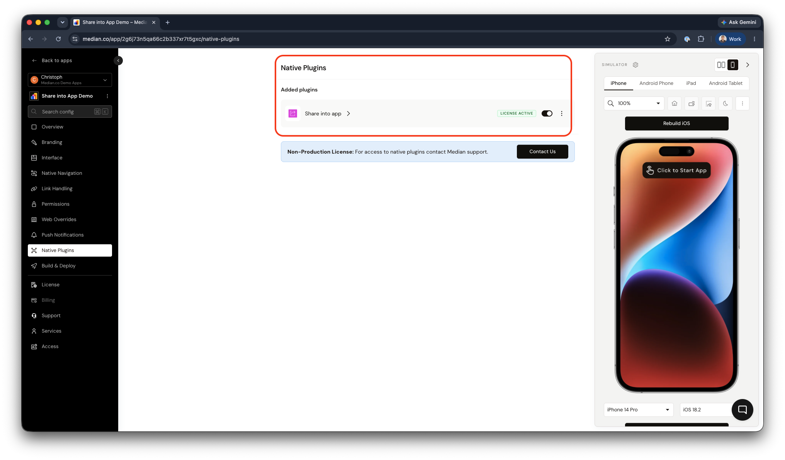
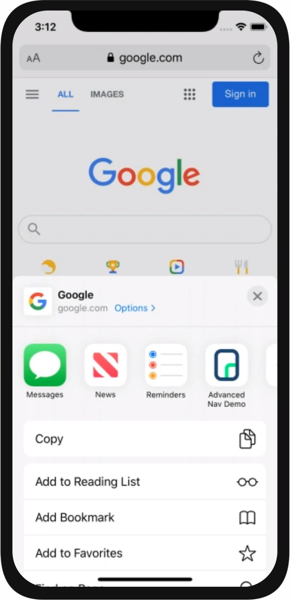
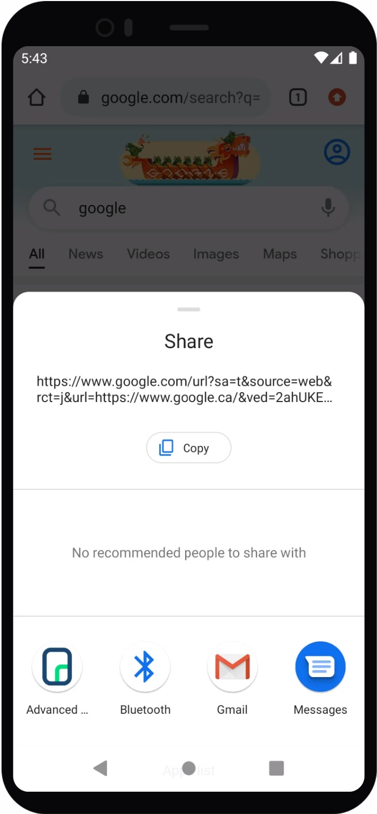

import { MedianLogo } from "/snippets/median-logo.jsx";
import { AppetizeEmbed } from "/snippets/appetize-embed.jsx";

Share into App provides a native share extension that bridges the operating system share UI with your web app's JavaScript. When a user selects your app from the share sheet, the app launches and invokes a JavaScript callback you define, passing the shared URL and subject.

Once configured, your app appears as a target option when a user shares a URL on their device. This lets you capture shared URLs and page titles directly in your JavaScript, making it easy to act on content users find anywhere on the web.

<Check>
  **Developer Demo**

  Display our demo page in your app to test during development <br />[https://median.dev/share-into-app/ ](https://median.dev/share-into-app/)<Icon icon="arrow-up-right-from-square" size={12} />
</Check>

## Why use share into app

- **Native system integration**: Your app appears directly in the iOS Share Sheet and Android Share Menu, so users can share into your app from any browser or native app.
- **Deep linking shared content**: Shared URLs launch your app and deliver the URL and page title to a JavaScript callback you control, enabling any downstream action.
- **Broad app compatibility**: Ideal for social apps, bookmarking tools, productivity platforms, and any app that benefits from capturing web content users discover outside your app.

## Implementation guide

### App configuration

1. **Navigate to Native Plugins**: In Median App Studio, go to the Native Plugins section.
2. **Enable Share into App**: Toggle the plugin to enabled status.

<Frame caption="App Studio – Enable Share into App">
  
</Frame>

#### iOS configuration

Add an **App Group** identifier to the Share into app plugin configuration. Enter the bare iOS Bundle ID of your app (for example `com.example.app`), **not** the prefixed identifier — the platform derives the App Group as `group.<bundleId>` internally.

<Warning>
  **App Groups must be set up manually in the Apple Developer Portal**

  The App Group cannot be created through the Median platform. <br /><br />You must register it in the [Apple Developer Portal ](https://developer.apple.com/account/resources/identifiers)<Icon icon="arrow-up-right-from-square" size={12} /> and enable it on **both** your app's App ID and its `<bundleId>.ShareExtension` App ID. A release build will not work without it — see [Building an iOS Binary with App Groups Entitlement](/docs/building-an-ios-binary-for-apps-using-app-groups-entitlements).
</Warning>

You will also need to set up the URL scheme protocol. You can find this setting in the **Link Handling** section in App Studio.

### JavaScript Bridge functions

Define a JavaScript function named `median_share_to_app(data)` on your website. When a user selects your app from the system share sheet with a webpage URL, your app launches and calls this function, so you can capture and use the shared data, such as the URL and page title or shared text.

<MedianLogo />

<CodeGroup>

```javascript JavaScript
function median_share_to_app(data) {
  alert(data.url); // Shared URL
  alert(data.subject); // Page title or shared text
}
```

</CodeGroup>

<Columns cols={2}>
  <Frame caption="iOS – Share sheet">
    
  </Frame>
  <Frame caption="Android – Share menu">
    
  </Frame>
</Columns>

## Demo app

You can test the full share flow using our virtual demo app on iOS and Android simulators.

<Info>
  **Demo Instructions**

  1. Open any webpage (e.g., [median.co <Icon icon="arrow-up-right-from-square" size={12} />](https://median.co)) in the mobile browser.
  2. Tap the browser’s Share or Send to menu.
  3. Select the **Share into App Demo** from the list of target apps.
  4. The demo app will launch and invoke the JavaScript callback with the shared URL and metadata.
</Info>

<AppetizeEmbed iosEmbedCode="737mg6d5xfirj6x6vsageoin6y" androidEmbedCode="acfjrmtur3qqx7skca5brpukpy" />

## Testing checklist

Use this checklist to ensure Share into App is working correctly in your app:

- [ ] Your app appears in the native Share Sheet (iOS) and Share Menu (Android)
- [ ] Selecting your app from the share sheet launches the app correctly
- [ ] Sharing a URL triggers the `median_share_to_app(data)` callback

## Frequently asked questions

<AccordionGroup>
  <Accordion title="Share into App functions don't load or don't run">
    Enable the JavaScript Bridge in Median App Studio and define `median_share_to_app` on your website before the native callback fires. Also confirm that you enabled the plugin in your app configuration.
  </Accordion>

  <Accordion title="App does not appear in the iOS Share Sheet?">
    Verify that the App Group identifier in the Share into App plugin configuration matches the App Group you registered in your Apple Developer Account. Also confirm that you have configured the URL scheme protocol in the Link Handling section of App Studio.
  </Accordion>

  <Accordion title="The callback fires but data.url or data.subject is empty?">
    Check that your `median_share_to_app` function reads `data.url` for the shared URL and `data.subject` for the page title or shared text. Confirm the user is sharing a URL that provides both values as not all share sources supply a subject.
  </Accordion>

  <Accordion title="Share into App does not work after enabling the plugin?">
    After enabling the plugin in App Studio, rebuild and redeploy your app. Plugin configuration changes require a new binary before they take effect on device.
  </Accordion>
</AccordionGroup>
