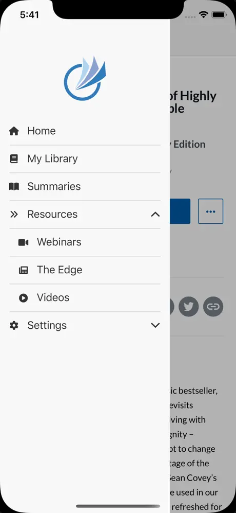
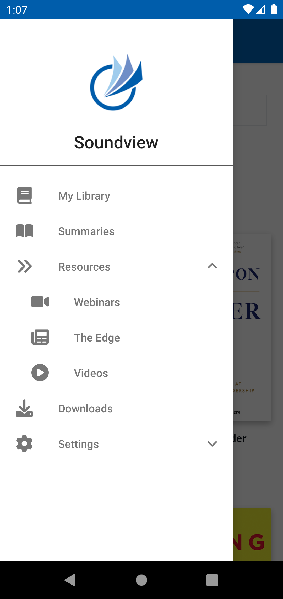

The sidebar navigation menu is a native slide-out menu, opened from the top navigation bar, that gives users quick access to the main sections of your app. Set up the menu items in App Studio with the [Sidebar Visual Editor](/docs/sidebar-configuration), or update them at runtime with the JavaScript Bridge.

<Check>
**Developer Demo**

Display our demo page in your app to test during development [https://median.dev/sidebar-navigation/ <Icon icon="arrow-up-right-from-square" size={12} />](https://median.dev/sidebar-navigation/)

</Check>

## Sample sidebar menus

<Columns cols={2}>
  <Frame caption="iOS – Sidebar menu">
    
  </Frame>
  <Frame caption="Android – Sidebar menu">
    
  </Frame>
</Columns>
