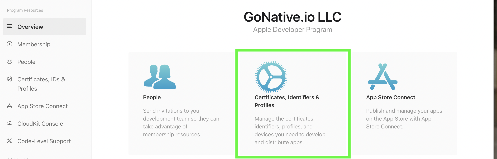
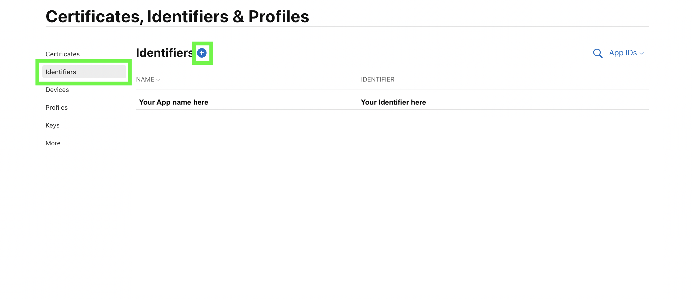
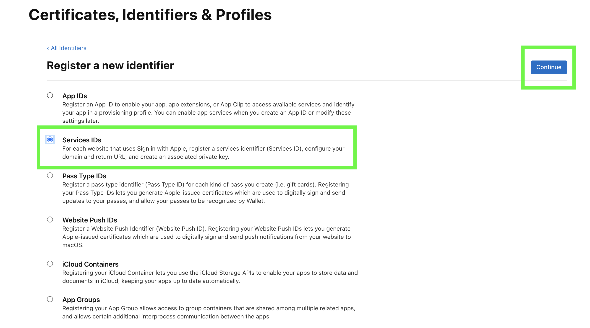
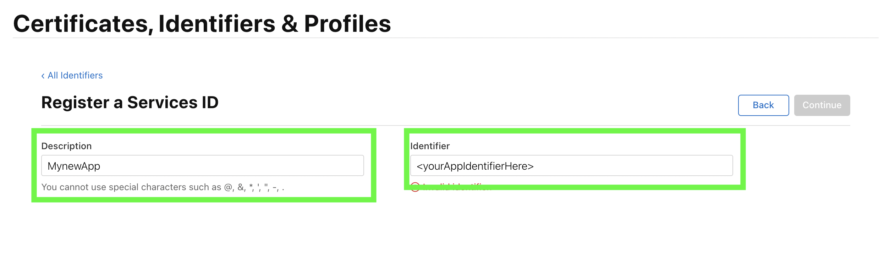
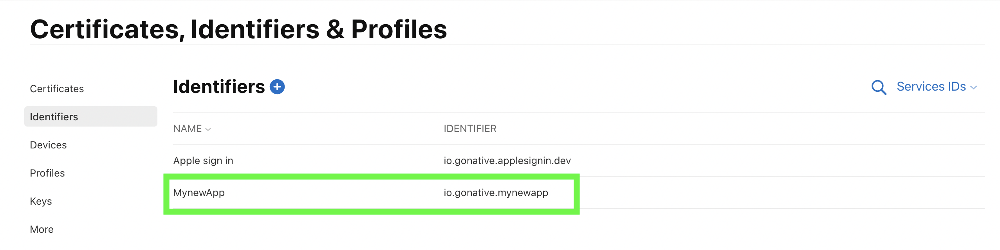
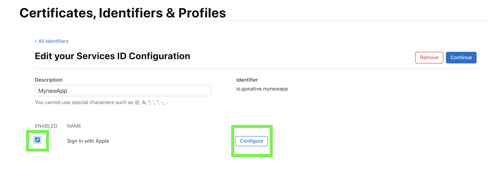
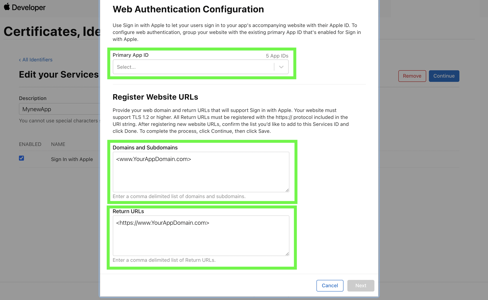
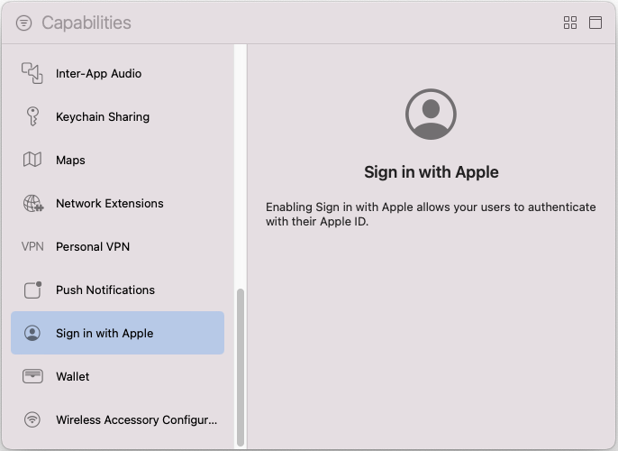

This guide walks you through configuring Sign in with Apple for your Median app. You'll register a Service ID in Apple Developer Portal, configure web authentication, and confirm the required iOS capability.

## Before you start

Make sure you have:

* An Apple Developer account ([create one here <Icon icon="arrow-up-right-from-square" size={12} />](https://developer.apple.com/account/))
* Your app's **iOS Bundle ID** (example: `co.median.ios.soclogin`)
* Your **website domain** (example: `yourdomain.com`)
* Your **return URLs** for authentication callbacks
* Admin or Account Holder role in Apple Developer account

**Not sure where to find these?** Check our [App Identifiers Guide](/docs/app-identifiers).

<Info>
  **Sign in with Apple is iOS only**

  Sign in with Apple is only available for iOS apps. Android does not support this authentication method.
</Info>

## Step 1: Register a new Service ID

### 1.1 Access identifiers

1. Log in to your [Apple Developer Account <Icon icon="arrow-up-right-from-square" size={12} />](https://developer.apple.com/account/).
2. Click **Certificates, Identifiers & Profiles**.

   <Frame caption="Apple Developer – Certificates, Identifiers & Profiles">
     
   </Frame>

### 1.2 Create new identifier

1. In the left navigation, click **Identifiers**.
2. Click the **+** button to create a new identifier.

   <Frame caption="Apple Developer – Identifiers">
     
   </Frame>

3. Select **Services IDs**.
4. Click **Continue**.

   <Frame caption="Apple Developer – Select Services IDs">
     
   </Frame>

## Step 2: Configure Service ID

### 2.1 Add Service ID details

1. **Description**: Add a user-friendly description of your app.
2. **Identifier**: Enter your app identifier (this will be your **Client ID**).
   * Example: `co.median.ios.soclogin.signin`.
3. Click **Continue**.
4. Click **Register**.

   <Frame caption="Apple Developer – Register a Services ID">
     
   </Frame>

**Save your Identifier** - This is your **Client ID** for Sign in with Apple (though no additional parameters are required in Median App Studio, as it uses your Bundle ID automatically).

## Step 3: Configure web authentication

### 3.1 Select your Service ID

1. In the Identifiers list, click the **Service ID you just created**.

   <Frame caption="Apple Developer – Select your Services ID">
     
   </Frame>

2. Check the box next to **Sign in with Apple**.
3. Click **Configure**.

   <Frame caption="Apple Developer – Enable Sign in with Apple and click Configure">
     
   </Frame>

### 3.2 Add domains and return URLs

1. **Primary App ID**: Select your app's primary identifier from the dropdown.
2. **Domains and Subdomains**: Add your website domains.
3. **Return URLs**: Add your authentication callback URLs.

   <Frame caption="Apple Developer – Web Authentication Configuration">
     
   </Frame>

   **Important formatting rules:**

   * Domains should **not** start with `https://`
   * Domains should **not** include a trailing `/`
   * **Correct**: `subdomain.yoursite.com`
   * **Incorrect**: `https://subdomain.yoursite.com/`

   **Example configuration:**

   * **Primary App ID**: `co.median.ios.soclogin`
   * **Domains and Subdomains**: `yourdomain.com`
   * **Return URLs**: `https://yourdomain.com/auth/apple/callback`

4. Click **Done**.
5. Click **Continue**.
6. Click **Save**.

## Step 4: Confirm Sign in with Apple Capability

### 4.1 Add capability

For App Studio builds using the App Store Connect API workflow, Median can register the Bundle ID with the Sign in with Apple capability and generate the provisioning profiles used by your build. If you manually manage Apple identifiers/provisioning profiles or build from downloaded source, add the capability in Xcode:

1. Open your project in Xcode.
2. Select your app target.
3. Click the **Signing & Capabilities** tab.
4. Click **+ Capability**.
5. Search for and add **Sign in with Apple**.

   <Frame caption="Xcode – Add the Sign in with Apple capability">
     
   </Frame>

<Warning>
  **Required for iOS**

  Failing to include the Sign in with Apple capability will result in Error Code 1000: `Error Domain=com.apple.AuthenticationServices.AuthorizationError Code=1000 "(null)"`
</Warning>

## Step 5: Enable the plugin in the Median App Studio

Sign in with Apple requires minimal configuration in Median App Studio.

1. Log in to [Median App Studio <Icon icon="arrow-up-right-from-square" size={12} />](https://median.co/app).
2. Navigate to: **Native Plugins** → **Social Login** → **Settings**.
3. **Enable Sign in with Apple**.

   **Configuration:**

   * **No additional parameters required**
   * Sign in with Apple uses your app's **Bundle ID** automatically
   * The Service ID you created is for web authentication only

4. Click **Confirm** and **Save**.
5. **Rebuild your app** for the changes to take effect.

## Step 6: Testing

If `email: null` is received, then reset the **Sign in with Apple** session.

Apple only returns the complete user profile for the first initial login by a user. Subsequent logins to your app using Sign in with Apple from the same Apple ID will only return `idToken` and `email` will be null.

During testing, you may reset the login session for your test account to simulate an initial login and return the complete user profile. To do this log in to your Apple account at [https://appleid.apple.com/account/manage <Icon icon="arrow-up-right-from-square" size={12} />](https://appleid.apple.com/account/manage) and go to "**Sign in and Security**" > "**Sign in with Apple**". In the window that opens click your app and then select "**Stop using Sign in with Apple**".

When you now use the **Sign in with Apple** in your app again, it will create a new session, and return the complete user profile for you to process and save.
