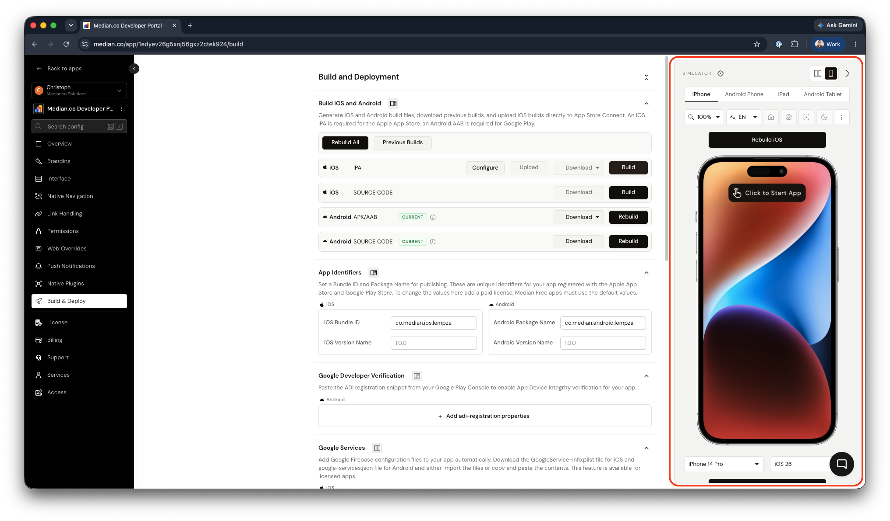
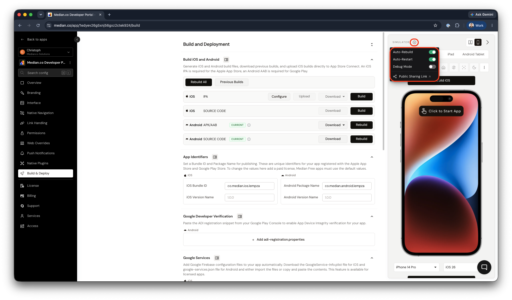
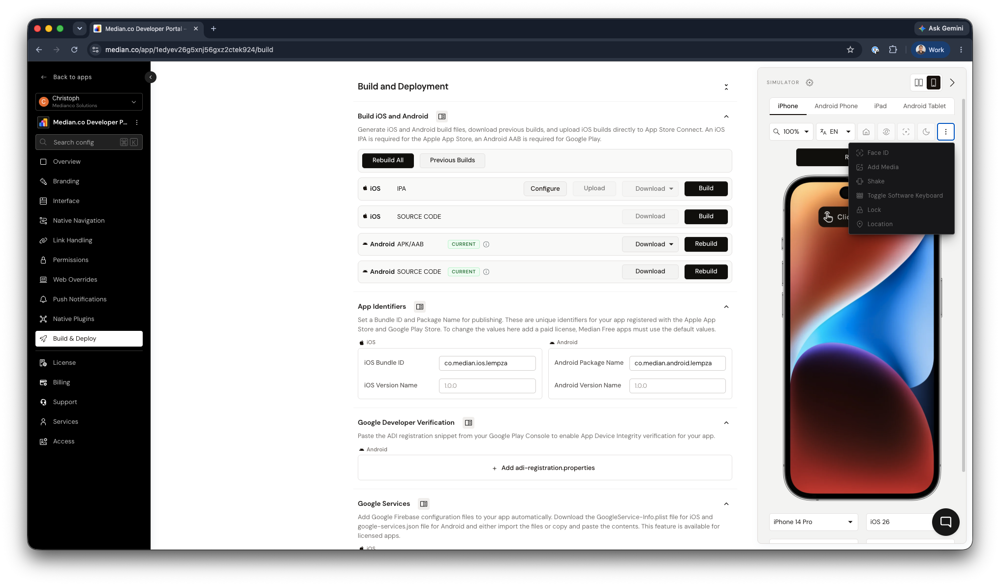

Every app in the Median App Studio comes with cloud-based iOS and Android device simulators built right into the editor. As you change your configuration, the simulator rebuilds and relaunches your app so you can see the effect immediately, without downloading a build or owning a physical device.

Use the simulators to check navigation, styling, permissions, native features and device-specific behavior throughout your build, not just at the end.

<Frame caption="The simulator panel in the App Studio">
  
</Frame>

## Starting the simulator

<Steps>
  <Step title="Choose a platform">
    Select **iPhone**, **Android Phone**, **iPad** or **Android Tablet** from
    the tabs at the top of the simulator panel.
  </Step>
  <Step title="Pick a device and OS version">
    Use the dropdowns below the device to choose a specific model (for example,
    iPhone 14 Pro or Pixel 8) and operating system version (for example, iOS 26
    or Android 14).
  </Step>
  <Step title="Wait for the build">
    The progress bar above the device shows the build status (for example,
    **Building iOS...**). Building takes a short while the first time and after
    configuration changes.
  </Step>
  <Step title="Click to Start App">
    Once the build is ready, click **Click to Start App** on the device screen
    to launch a simulator session with your app.
  </Step>
</Steps>

<Tip>
  Test on at least one phone and one tablet for each platform, and on both an
  older and the latest OS version you support. Layout and WebView behavior can
  differ noticeably between them.
</Tip>

## Simulator settings

Click the **gear icon** next to **Simulator** to open the simulator settings.

<Frame caption="Simulator settings">
  
</Frame>

| Setting                 | What it does                                                                                                                                                          |
| ----------------------- | --------------------------------------------------------------------------------------------------------------------------------------------------------------------- |
| **Auto-Rebuild**        | Automatically rebuilds the simulator app whenever you save a configuration change in the App Studio.                                                                  |
| **Auto-Restart**        | Automatically restarts the app in the simulator after a rebuild, so you're always looking at your latest configuration.                                               |
| **Debug Mode**          | Opens additional controls below the simulator to launch the web console logs or Appetize.                                                                             |
| **Public Sharing Link** | Opens a shareable link to a simulator of your app that anyone can use without an App Studio login. Useful for sharing progress with stakeholders, testers or clients. |

<Note>
  If you're making a series of changes and don't want the simulator to rebuild
  after each one, turn off **Auto-Rebuild** and rebuild manually when you're
  ready.
</Note>

## Toolbar controls

The toolbar above the device gives you quick access to common device actions.

<Frame caption="More device actions">
  
</Frame>

| Icon | Control                | What it does                                                                                                                                                           |
| ---- | ---------------------- | ---------------------------------------------------------------------------------------------------------------------------------------------------------------------- |
| ---- | **Zoom** (e.g. 100%)   | Scales the device in the panel. Lower it to fit large devices such as tablets on smaller screens.                                                                      |
| ---- | **Language** (e.g. EN) | Sets the device language, so you can check [localized](/docs/localization) app content, native UI strings and right-to-left layouts.                                   |
| ---- | **Home**               | Presses the device home button, sending your app to the background. Use it to test background/foreground behavior such as session handling and push notification taps. |
| ---- | **Rotate device**      | Rotates the device between portrait and landscape orientations.                                                                                                        |
| ---- | **Screenshot**         | Captures the current device screen.                                                                                                                                    |
| ---- | **Dark mode**          | Toggles the device between light and dark appearance, so you can verify your app and website respond to the system color scheme. See [Dark mode](/docs/dark-mode).     |

### More device actions

Click the **⋮** menu at the end of the toolbar for additional device actions. These become available once a session is running.

| Action                       | What it does                                               | Useful for testing                                                                                                       |
| ---------------------------- | ---------------------------------------------------------- | ------------------------------------------------------------------------------------------------------------------------ |
| **Face ID**                  | Simulates a biometric authentication prompt being matched. | Biometric login with the [Face ID / Touch ID](/docs/apple-face-id-touch-id) plugin.                                      |
| **Add Media**                | Uploads an image or video to the device.                   | File uploads, photo pickers and camera roll access. See [Camera and file uploads](/docs/camera-and-file-uploads).        |
| **Shake**                    | Simulates shaking the device.                              | Shake gestures and any features triggered by device motion.                                                              |
| **Toggle Software Keyboard** | Shows or hides the on-screen keyboard.                     | Forms, input focus, and how your layout behaves when the keyboard covers part of the screen.                             |
| **Lock**                     | Locks the device screen.                                   | Lock/unlock behavior, session timeouts and app resume handling.                                                          |
| **Location**                 | Sets the device's GPS location.                            | Geolocation features, location permissions and location-based content. See [Location services](/docs/location-services). |

## Layout options

Use the toggle in the top-right of the simulator panel to switch the panel layout to compare two devices side-by-side. This is useful for checking how your app looks on different screen sizes, orientations and platforms.

## What the simulators can and can't test

The simulators run a real build of your app, so most configuration and native features behave as they will on a device. A few things need a physical device:

- Some third-party SDK integrations can't run in a simulator. Plugin documentation notes when this is the case.
- Push notification delivery, in-app purchases, camera capture, NFC, Bluetooth and similar hardware-dependent features should be verified on a real device.
- Performance on a simulator doesn't reflect real device performance as the simulator runs in a data center with optimized connection speeds.

When you're ready to test on hardware, see [Build & test overview](/docs/development-test-deep-dive).

## Session limits

Simulator sessions have a limited runtime and number of sessions depending on your plan. Enterprise customers receive extended runtime and unlimited simulator sessions.

You can find the latest session limits on our public [Pricing page](https://median.co/pricing).

## Frequently asked questions

<AccordionGroup>
  <Accordion title="My website blocks the simulator. Which IP addresses should I allow?">
    The simulators run in data centers across several regions. If your website
    or API restricts access by IP, allowlist the IP blocks listed at
    [median.co/ip-blocks](https://median.co/ip-blocks).
  </Accordion>
  <Accordion title="My changes aren't showing in the simulator">
    Check that **Auto-Rebuild** and **Auto-Restart** are turned on in the
    simulator settings, or rebuild and restart manually. Website content changes
    appear on reload, but App Studio configuration changes require a rebuild.
  </Accordion>
  <Accordion title="Why are the actions in the ⋮ menu greyed out?">
    Device actions are only available while the app is running. Click **Click to
    Start App** to start a session first.
  </Accordion>
  <Accordion title="Can I share the simulator with someone who doesn't have an App Studio account?">
    Yes. Open the simulator settings and click **Public Sharing Link** to get a
    link anyone can open in their browser.
  </Accordion>
</AccordionGroup>
