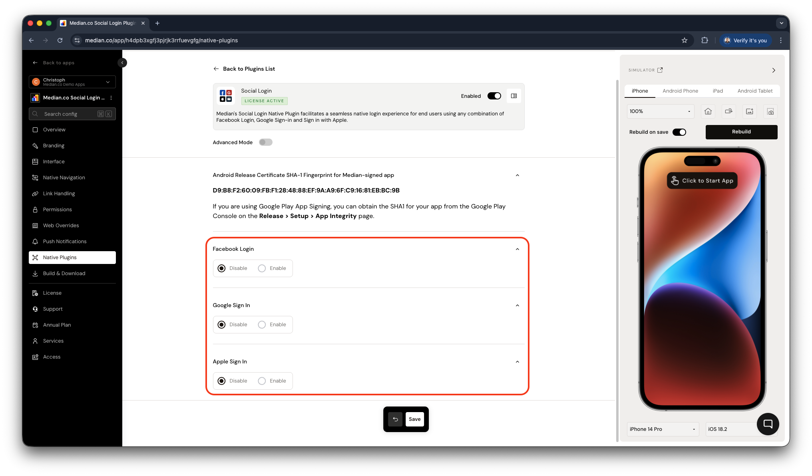
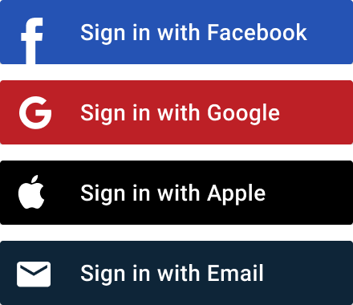

Enable secure, native sign-in for your app users with **Facebook Login**, **Google Sign-In**, and **Sign in with Apple**. Median's Social Login plugin uses native SDKs, so users who are already authenticated on their devices can sign in automatically.

## Before you start

Make sure you have:

- Developer accounts for each provider (Facebook, Google, Apple)
- Your app's Bundle ID (iOS) and Package Name (Android)
- Access to your website's codebase
- Basic understanding of OAuth authentication

## Complete setup process

Setting up social login involves the following four steps:

### Step 1: Configure identity providers

Configure each provider in their respective developer portals:

<Columns cols={1}>
  <Card
    title="Configure Facebook Login"
    icon="facebook"
    href="/docs/facebook-login-configuration"
  >
    Set up your Facebook App and add iOS/Android platforms. _Requires: Bundle
    ID, Package Name, Key Hash_
  </Card>
  <Card
    title="Configure Google Sign-In"
    icon="google"
    href="/docs/google-sign-in-configuration"
  >
    Create OAuth clients for all platforms in Google Cloud. _Requires: Bundle
    ID, Package Name, SHA-1 Certificate_
  </Card>
  <Card
    title="Configure Sign in with Apple"
    icon="apple"
    href="/docs/sign-in-with-apple-configuration"
  >
    Register Service ID and set up web authentication. _Requires: Bundle ID,
    website domains, redirect URLs_
  </Card>
</Columns>

### Step 2: Add credentials to Median App Studio

Enter the credentials from Step 1 into your Social Login configuration in Median App Studio.

**You'll need these credentials based on the providers you want to enable:**

| Provider | Parameters                         |
| -------- | ---------------------------------- |
| Facebook | App ID, Display Name, Client Token |
| Google   | iOS Client ID, Android Client ID   |
| Apple    | iOS Bundle ID                      |

<Frame caption="Social Login plugin configuration">
  
</Frame>

### Step 3: Update your website for native social login

Integrate the Median JavaScript Bridge so your website can trigger native login flows.

The Social Login plugin includes a set of images you can use as buttons to trigger the JavaScript Bridge functions that launch each of the native SDKs (SVG and high-resolution @2x and @3x PNG formats are available). See the [website configuration guide](/docs/social-login-website-configuration).

<Frame caption="Social login example logos">
  
</Frame>

### Step 4: Rebuild your app and test

After configuration, rebuild your app and test sign-in for each identity provider.

Preview social login in your app during development: [load our demo page](https://median.dev/social-login/).

This demo page includes test buttons for all three providers so you can verify your configuration works before integrating with your website.

## Implementation guides

Update your website and server configuration to integrate with the Social Login plugin:

<Columns cols={3}>
  <Card
    title="Website configuration"
    icon="code"
    href="/docs/social-login-website-configuration"
  >
    Implement JavaScript Bridge functions in your website to trigger native
    authentication flows from your mobile app.
  </Card>
  <Card
    title="Server-side redirects"
    icon="server"
    href="/docs/social-login-server-side-redirects"
  >
    Configure server-side redirect handling to properly manage authentication
    callbacks and token exchanges.
  </Card>
  <Card
    title="JavaScript callbacks"
    icon="external-link"
    href="/docs/social-login-javascript-callbacks"
  >
    Handle authentication responses and user data returned from native SDKs
    through JavaScript callback functions.
  </Card>
</Columns>
