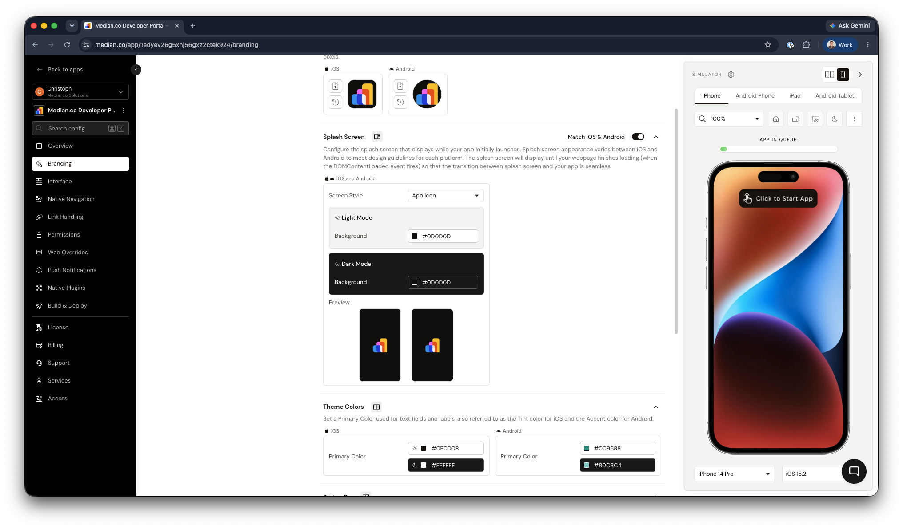
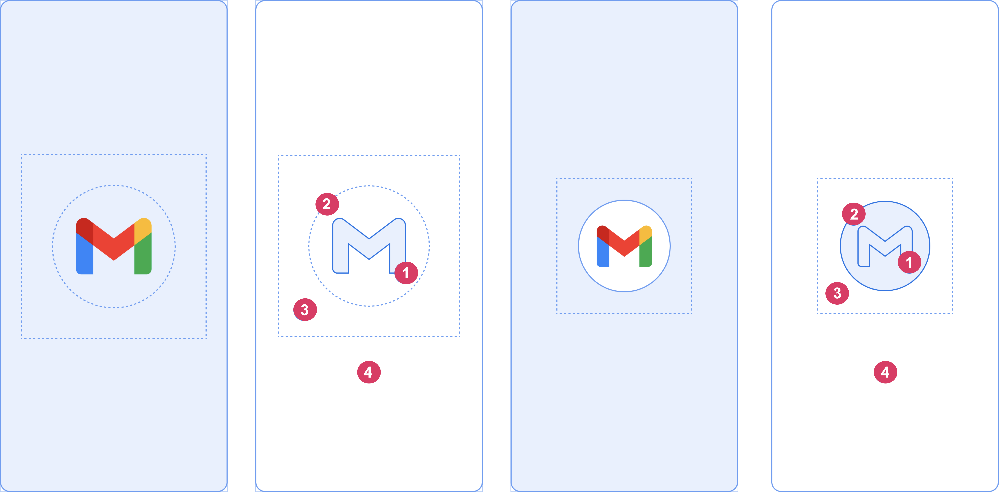
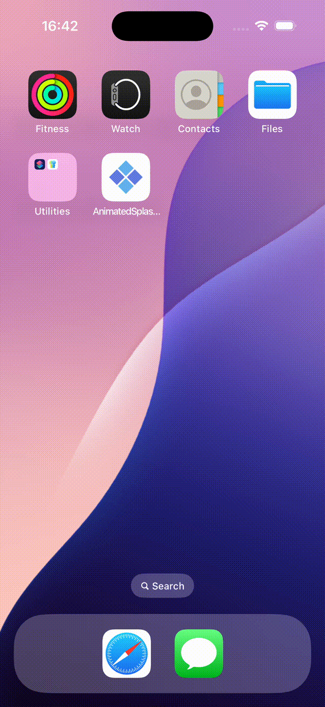
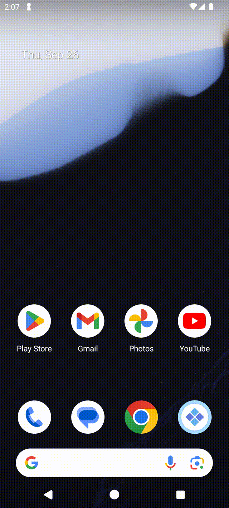
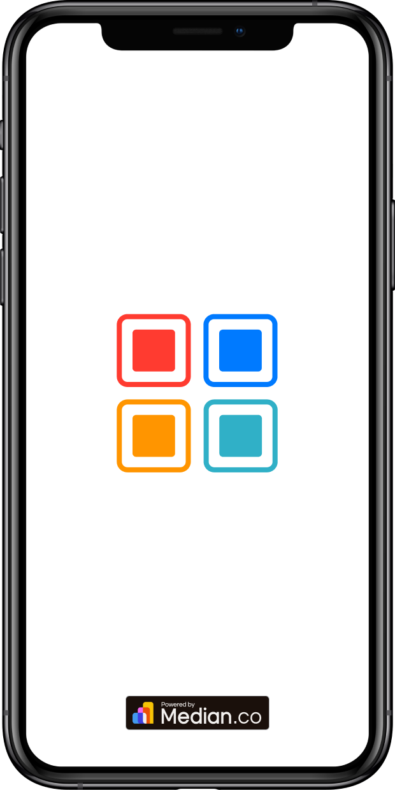
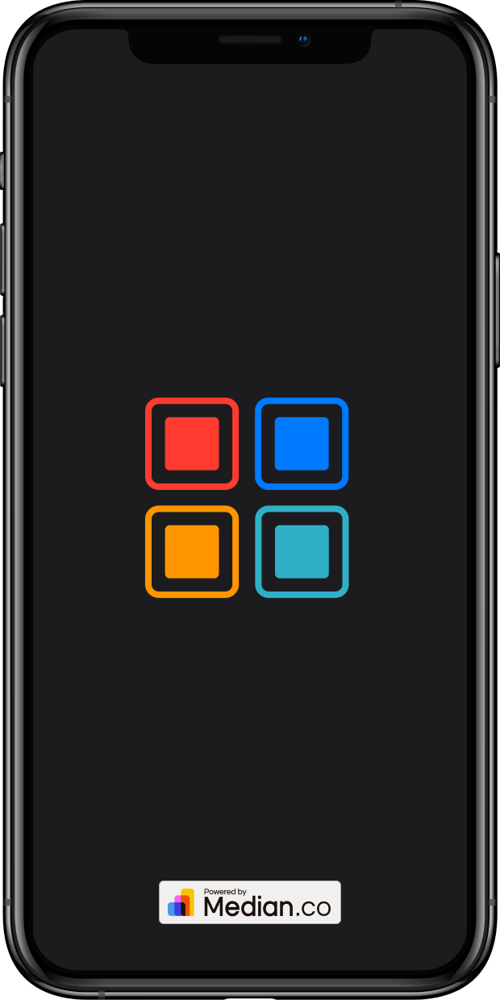

import { DeveloperDemo } from "/snippets/developer-demo.jsx";

The splash screen is the first thing users see when they launch your app from the home screen or switch back to it from the background. With Median, you can customize the splash screen with a static image or an animation, and set separate configurations for light mode and dark mode.

During initial app launch, the splash screen displays while your web content is loading. It stays on screen until the web page finishes loading (until the `DOMContentLoaded` event fires), so that the transition between splash screen and your app is frictionless. We provide a test page on our developer portal that can be used to simulate long page load times, allowing you to test the splash screen experience for users on slow network connections.

<DeveloperDemo path="splash-screen-transition" />

## How to configure your splash screen

App Studio auto-generates a splash screen from your app icon, or you can upload a custom static image or animation. From there, you can fine-tune the experience for each platform using the options below.

<Frame caption="App Studio – splash screen configuration">
  
</Frame>

### iOS splash screen setup

iOS apps use a launch storyboard to render splash screens. This approach simplifies support across the wide range of iPhone and iPad screen sizes and resolutions, and it's required by Apple to properly support larger iPad devices at native resolution.

By default, App Studio generates your launch storyboard automatically from your app icon. If you want more control, open your iOS source code in Xcode and customize `LaunchScreen.storyboard`. For layout guidance, see Apple's [Launching guidelines <Icon icon="arrow-up-right-from-square" size={12} />](https://developer.apple.com/design/human-interface-guidelines/launching).

### Android splash screen setup

Starting with Android 12, Google standardized splash screen design to show a circular, cropped image centered on the screen. For the best results, use a simple, low-complexity image with minimal text similar in style to your app icon.

For full design specifications, see the [Android UI guidelines for splash screens <Icon icon="arrow-up-right-from-square" size={12} />](https://developer.android.com/develop/ui/views/launch/splash-screen#elements).

<Frame caption="Android – splash screen composition">
  
</Frame>

## Animated splash screen

Median supports animations created in Adobe After Effects and exported using the BodyMovin plugin in JSON format. There are free, ready-to-use animations available on [LottieFiles <Icon icon="arrow-up-right-from-square" size={12} />](https://lottiefiles.com).

<Columns cols={2}>
  <Frame caption="iOS – animated splash screen">
    
  </Frame>
  <Frame caption="Android – animated splash screen">
    
  </Frame>
</Columns>

<Warning>
  **Adobe After Effects & BodyMovin compatibility**

iOS and Android do not support some features available in the BodyMovin format such as blend modes, which are only supported on the web. Always test your exported animation file on-device to confirm it renders as expected before publishing.

</Warning>

## Free tier splash screen

When you publish an app without a paid license under the Median Free offering, a "Powered by Median.co" watermark appears on the splash screen in the production version of your app. The splash screen displays while your web content loads and then disappears when your content has loaded.

You can configure your splash screen to use the same image as your app icon or a different image. You can also set different images and background colors for light mode and dark mode.

<Columns cols={2}>
  <Frame caption="Free tier splash screen – light mode">
    
  </Frame>
  <Frame caption="Free tier splash screen – dark mode">
    
  </Frame>
</Columns>

## Frequently asked questions

<AccordionGroup>
  <Accordion title="Does the splash screen support dark mode?">
    Yes. You can configure a separate splash screen image, animation, and background color for both light mode and dark mode.
  </Accordion>

<Accordion title="How long does the splash screen stay on screen?">
  It remains visible until your web page's `DOMContentLoaded` event fires, so
  the app never shows a blank screen while content loads. With animations, you
  can choose whether it also waits for a full animation cycle to complete.
</Accordion>

<Accordion title="What animation format does Median support?">
  BodyMovin JSON exports from Adobe After Effects.
</Accordion>

  <Accordion title="Can I remove the 'Powered by Median.co' watermark?">
    Yes. The watermark only appears on the Median Free plan. Upgrading to a paid app license removes it from your splash screen.
  </Accordion>
</AccordionGroup>
