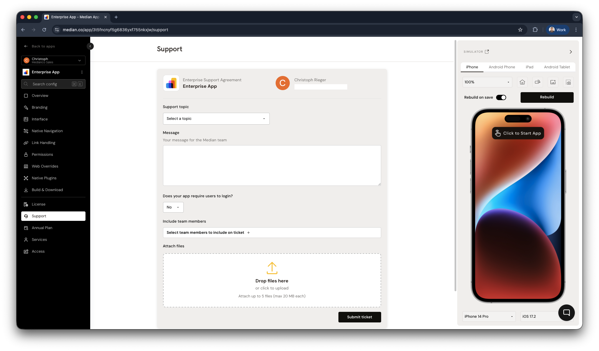

Whether your app is in development, testing, publishing, or ongoing maintenance, Median's support team helps you maintain native iOS and Android apps, even without in-house mobile resources.

## Support plans

Median offers tiered support options to match your team's needs and app complexity. See our [pricing page](https://median.co/pricing) for a full comparison.

### Business support

Our Business Annual Plan provides technical support at affordable annual rates. Pricing is based on your app's complexity, active native plugins, and any custom development components.

[Contact us](https://median.co/contact?topic=sales-inquiry) to learn more about Business support.

### Enterprise support

For customers with advanced technical, security, or compliance requirements, our Enterprise Annual Plan offers a fully customizable support solution. This plan can include:

* Enhanced app security features
* Service Level Agreement (SLA) terms tailored to your organization's needs
* Mobile Device Management (MDM) distribution support

[Contact us](https://median.co/contact?topic=sales-inquiry) to learn more about Enterprise support.

### Self-serve support

Customers without an active support plan can still get help by submitting questions through our [Community Support Portal](https://docs.median.co/discuss). Our team makes a best effort to respond to all inquiries, though response times may vary compared to paid plan holders.

## Submitting a support ticket for an app on an annual plan

*Applies to apps on a Business or Enterprise annual plan.*

### Opening a ticket via App Studio

The fastest way to submit a support request is directly from App Studio. This automatically associates your app with the ticket and assigns the appropriate priority based on your support plan.

1. Open your app in App Studio.
2. Click the **Support** tab in the left sidebar.
3. Fill in your issue description and submit.

<Frame caption="App Studio – contact Median support">
  
</Frame>

### Writing an effective support request

To help us diagnose and resolve your issue as quickly as possible, please include the following when submitting a ticket:

**Reproduction steps**

Provide clear, step-by-step instructions to replicate the issue. If signing in is required to reproduce it, include test credentials where possible.

**Visuals**

Attach screenshots or a screen recording that clearly demonstrates the problem.

**Technical details**

Include:

* Device make and model
* Operating system and version (iOS or Android)
* Whether the issue occurs on a simulator, physical device, or both

The more precise your information, the faster we can diagnose and resolve the issue.
