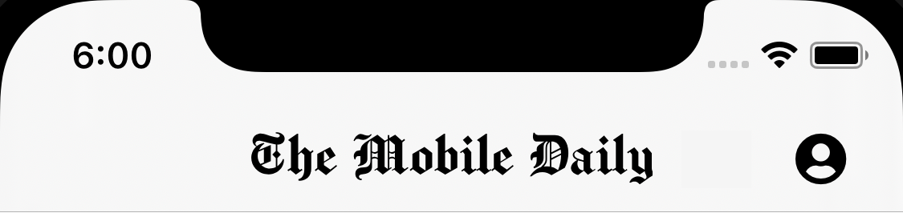
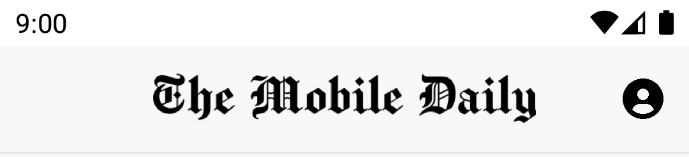

import { MedianLogo } from "/snippets/median-logo.jsx";

The top navigation bar is only visible if you are using [Sidebar Navigation](/docs/sidebar-navigation-menu), [Auto New Windows](/docs/auto-new-windows), [Search](/docs/search-bar-form), [Refresh Button](/docs/refresh-button), or [Custom Buttons](/docs/add-custom-buttons).

<Check>
**Developer Demo**

Display our demo page in your app to test during development <br /><br />[https://median.dev/top-navigation-bar/ <Icon icon="arrow-up-right-from-square" size={12} />](https://median.dev/top-navigation-bar/)

</Check>

## Example

<Frame caption="iOS Top Navigation Bar">
  
</Frame>

<Frame caption="Android Top Navigation Bar">
  
</Frame>

## Frequently asked questions

<AccordionGroup>
<Accordion title="How do I change the title text in the top navigation bar?">
  You can add the following to each page for which you wish to set a title.

<MedianLogo />

  <CodeGroup>

```html HTML
<script>
  function median_library_ready() {
    median.navigationTitles.setCurrent({ title: "Your Title" });
  }
</script>
```

  </CodeGroup>

For more details refer to [Dynamic Titles](/docs/dynamic-titles).

</Accordion>

</AccordionGroup>
