The recommended way to upload your iOS app to TestFlight with Median is directly from the **Median App Studio**.

With the App Store Connect API configured and **Upload to App Store Connect** set to **Automatic**, Median will build a signed distribution IPA in the cloud and upload it directly to App Store Connect. Before uploading, your **App Store Connect app record must already exist** with the same Bundle ID configured in the Median App Studio. After Apple finishes processing the build, you can add it to TestFlight for internal or external testing.

You do not need a Mac, Xcode, or Apple Transporter for this standard workflow.

## Recommended Workflow

1. Open your app in the Median App Studio and go to **Build & Deploy**.

2. Click **Configure** in the iOS IPA section.

3. In **Apple Developer API Connection**, enter your **Issuer ID** and **Key ID**, and upload your **Private Key (.p8)** file.

4. In **Bundle ID & App Store Connect App**:
   - Register the **Bundle ID** for your app.
   - Create the **App Store Connect app record** in App Store Connect using that Bundle ID.
   - Verify the **App Store Connect app record** in Median App Studio.

5. In **Signing & Upload Settings**, select **Distribution Profile** and set **Upload to App Store Connect** to **Automatic**.

6. Build your iOS IPA in the Median App Studio (if Automatic Upload is not selected you can manually click "Upload" after the build is complete).

7. Wait for Apple to process the uploaded build in App Store Connect.

8. In App Store Connect, open **TestFlight**, resolve any required prompts, and add testers.

## Manual Xcode Upload (Optional)

Use this workflow only if you intentionally choose to build your iOS app locally from downloaded source in Xcode.

Most Median self-publishing workflows do **not** require Xcode. For most developers, building in Median App Studio and uploading automatically to App Store Connect is the recommended approach.

### 1. Register app to App Store Connect

To upload your app for TestFlight, you will first need to register your app in your App Store Connect account by following the steps in the [official documentation <Icon icon="arrow-up-right-from-square" size={12} />](https://developer.apple.com/help/app-store-connect/create-an-app-record/add-a-new-app). This includes registering your app name and [bundle ID](/docs/app-identifiers).

### 2. Open app in Xcode

See [Build iOS from source](/docs/build-ios-from-source) to download and open iOS source code in Xcode.

In Xcode, select YOUR_APP from the left panel as seen in Figure 1:

<Frame caption="Figure 1: Xcode – Select your app">
  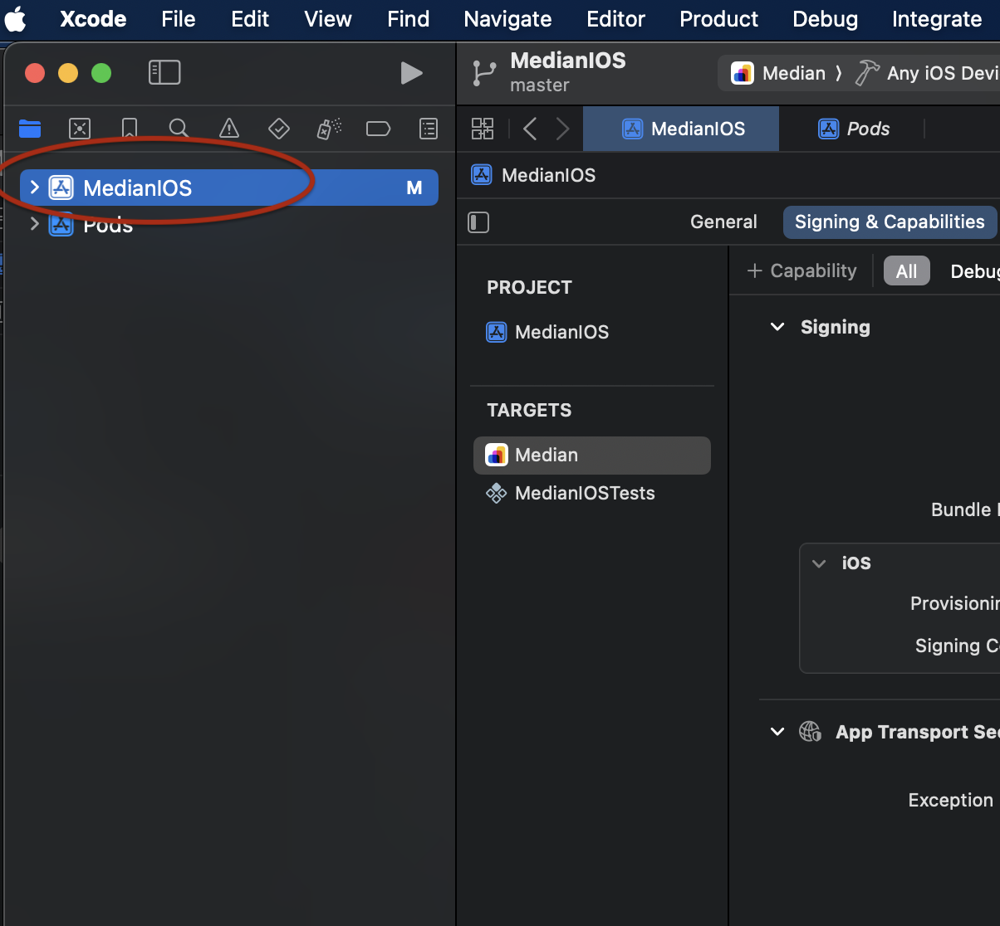
</Frame>

This will open another panel in the middle with various options. Select your target app in the "**TARGETS**" section and select "**Signing & Capabilities**". Now, choose your organization in the "**TEAM**" section and include your Bundle ID that you used to register your app in the previous section as shown in Figure 2:

<Frame caption="Figure 2: Xcode – Add signing configuration">
  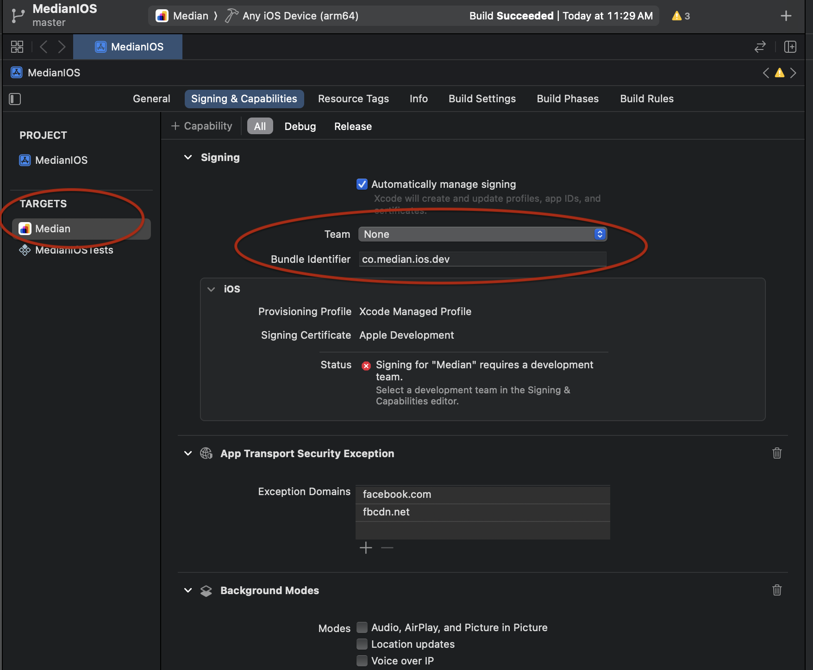
</Frame>

### 3. Archive your app

Now, select **Product > Archive** from the top to archive your app.

If there are no build errors, Xcode will open a new window with your newly archived app as seen in Figure 3.

<Frame caption="Figure 3: Xcode – Archived app">
  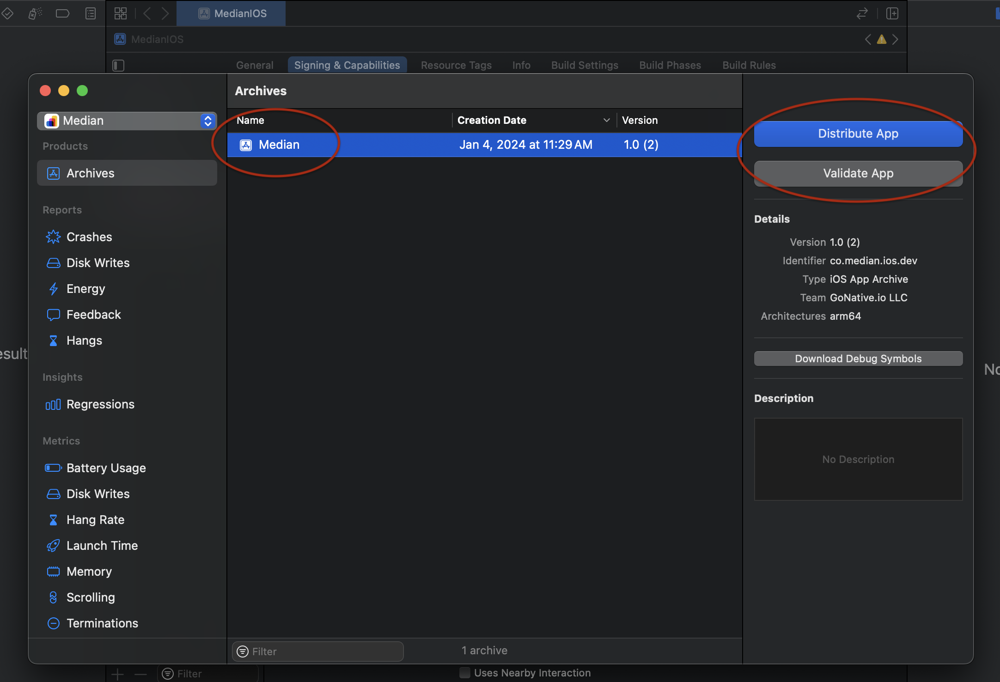
</Frame>

### 4. Validate your App

As seen in Figure 3, Xcode provides an option named "**Validate App**" to conduct an initial, automated limited assessment of the app and offer feedback. If you're looking to verify your app's readiness for TestFlight or the App Store submission without immediately submitting it, select your archive and then click on "**Validate App**".

<Frame caption="Figure 4: Xcode – Validate app">
  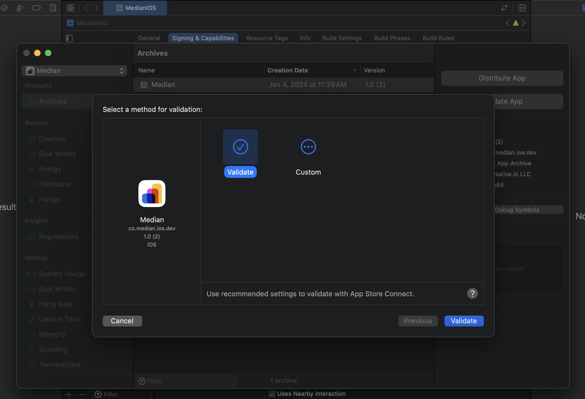
</Frame>

<Frame caption="Figure 5: Xcode – App validated">
  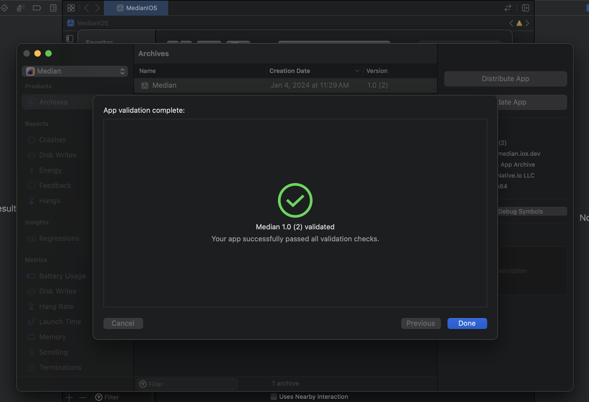
</Frame>

### 5. Distribute your app

When your app is successfully validated, you can proceed to distributing the app to TestFlight by selecting "**Distribute App**". Select "**TestFlight Internal Only**" to allow testing for internal testers of your organization as seen in Figure 6:

<Frame caption="Figure 6: Xcode – App distribution method">
  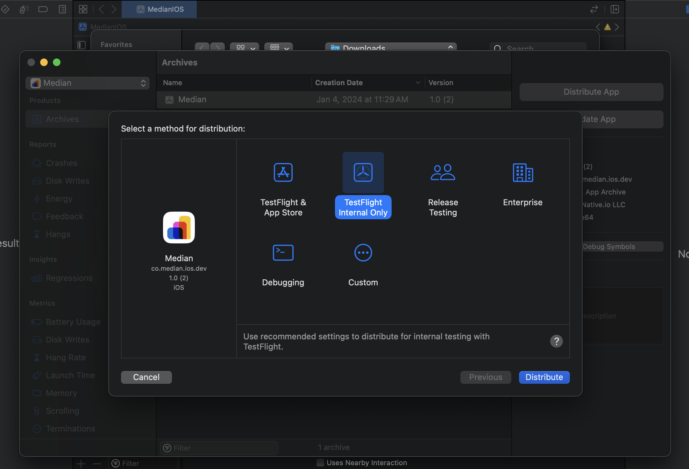
</Frame>

<Frame caption="Figure 7: Xcode – App upload complete">
  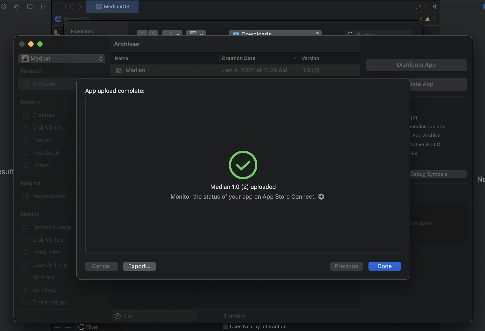
</Frame>

### 6. App Store Connect

Visit [App Store Connect's Apps page <Icon icon="arrow-up-right-from-square" size={12} />](https://appstoreconnect.apple.com/apps) and open your registered app from the list. Select "**TestFlight**" from the top bar to see your newly uploaded TestFlight distribution as seen in Figure 8 below.

<Frame caption="Figure 8: App Store Connect – TestFlight build with Missing Compliance">
  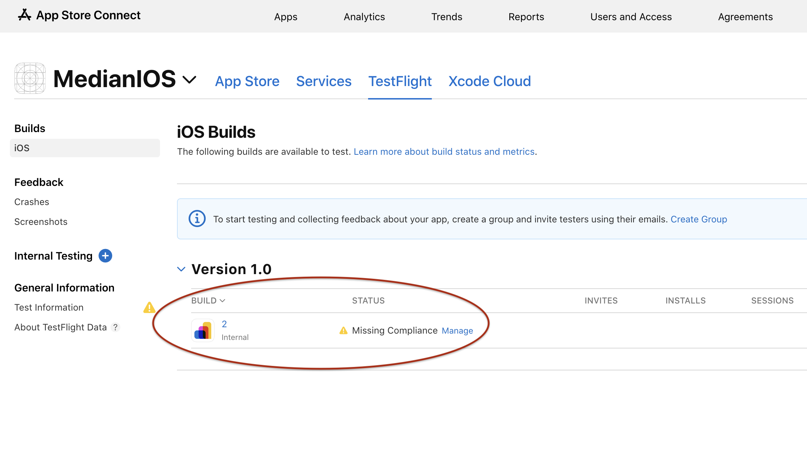
</Frame>

If you are seeing "**Missing Compliance**" such as above, click "**Manage**", choose "**None of the algorithms mentioned above**" from the options and hit "**Save**" as seen in Figure 9 below:

<Frame caption="Figure 9: App Store Connect – Resolve Missing Compliance">
  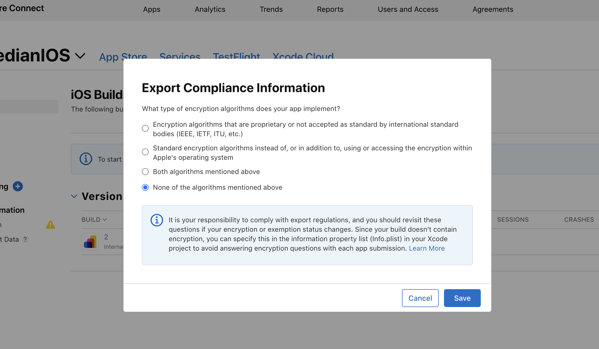
</Frame>

Now, you will see that your app is ready to be Tested as seen in Figure 10:

<Frame caption="Figure 10: App Store Connect – Build ready to test">
  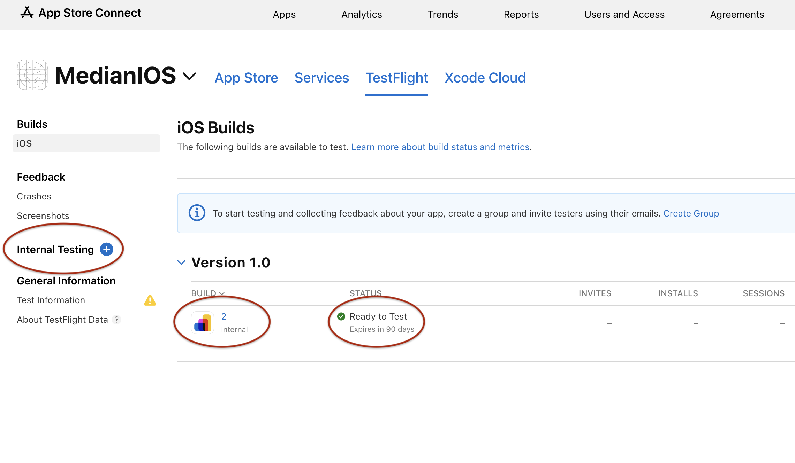
</Frame>

### 7. Add Internal Testers

Now, if you don't already have an internal testers group, click the "**+**" icon besides the "**Internal Testing**" label (see Figure 10) to create a new Internal Testers group as seen below in Figure 11:

<Frame caption="Figure 11: App Store Connect – Create new internal testing group">
  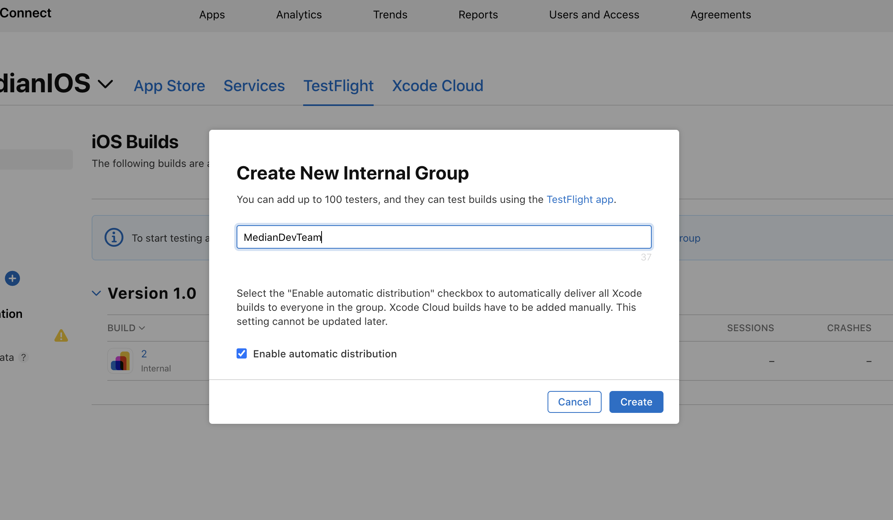
</Frame>

Once the group is created, it will appear directly below the "**Internal Testers**" label as seen previously. Click the newly created group and you will see the following page with an option named "**Testers (0)**" to add the testers:

<Frame caption="Figure 12: App Store Connect – New internal testing group">
  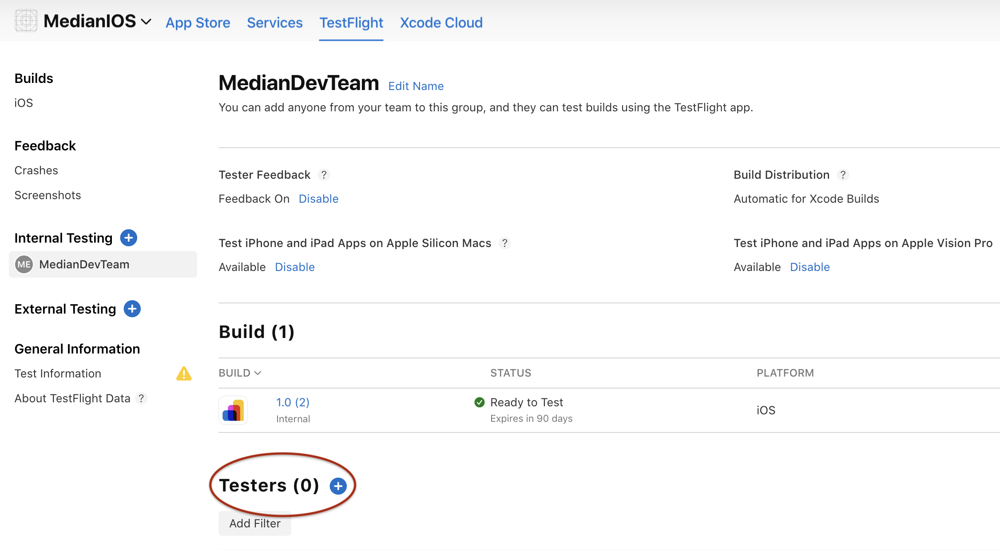
</Frame>

Click the "**+**" icon besides the "**Testers (0)**" label and add testers from the list of users in your organization. Once added, you will see the list of invited testers as seen in Figure 13 below:

<Frame caption="Figure 13: App Store Connect – Added testers">
  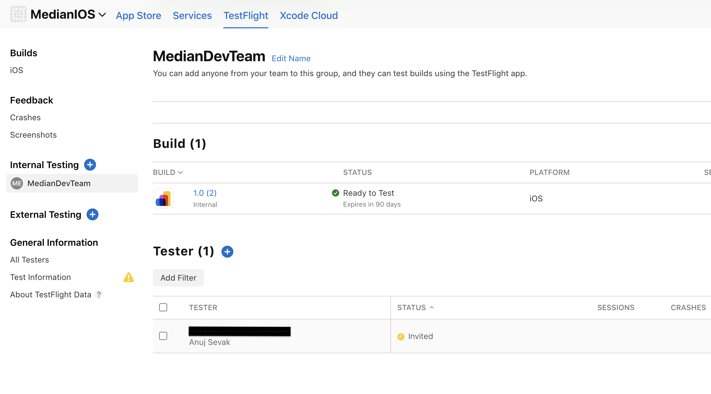
</Frame>

Each tester will receive an email invite that they can use to test the newly uploaded app on the **TestFlight** iOS app.

<Frame caption="Figure 14: Email – TestFlight invite">
  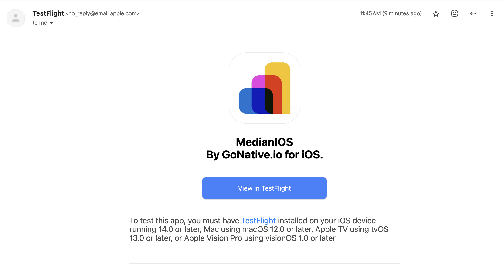
</Frame>

## Frequently Asked Questions

<Accordion title="Do TestFlight builds expire?">
  Yes. All builds uploaded to TestFlight are active for 90 days before they
  expire. For test access after the 90 days you can upload a new build.
</Accordion>
