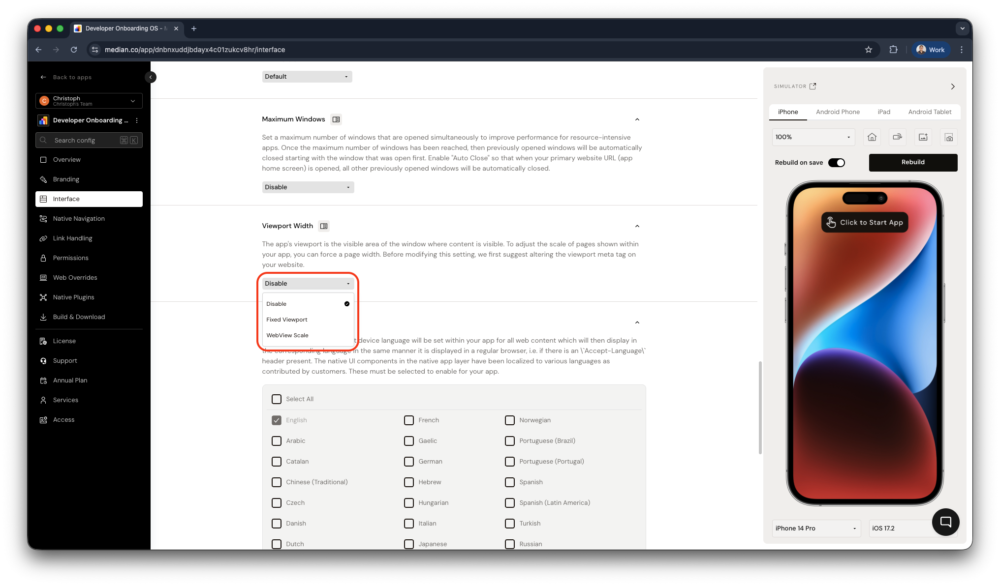

import { MedianLogo } from "/snippets/median-logo.jsx";

You can set the initial zoom level in App Studio during configuration, or control it dynamically using the Median JavaScript Bridge for runtime adjustments.

<Check>
**Developer Demo**

Display our demo page in your app to test during development [https://median.dev/webview-zoom/ <Icon icon="arrow-up-right-from-square" size={12} />](https://median.dev/webview-zoom/)

</Check>

## Implementation guide

You can control the webview zoom through initial configuration and through runtime JavaScript methods, for both static zoom settings and dynamic adjustments based on user interactions or content.

### App configuration

To use the WebView zoom feature, set **Viewport Width** to **WebView Scale** in the **Interface** settings of your app.

<Frame caption="App Studio – Interface – Viewport Width">
  
</Frame>

### JavaScript implementation

#### Get current zoom level

To retrieve the current zoom level of the webview:

<MedianLogo />

<CodeGroup>

```javascript JavaScript
median.webview.getZoom();
```

</CodeGroup>

#### Set zoom level

To set a new zoom level at runtime:

<MedianLogo />

<CodeGroup>

```javascript JavaScript
median.webview.setZoom(1.1); // Sets zoom to 110%
```

</CodeGroup>
